<!-- _class: portada -->


# UD2. INTRODUCCIÓN A JAVASCRIPT


---

# ¿Qué es JavaScript?

JavaScript es un lenguaje de programación que se utiliza principalmente para crear páginas web dinámicas.

Una página web dinámica es aquella que incorpora efectos como texto que aparece y desaparece, animaciones, acciones que se activan al pulsar botones y ventanas con mensajes de aviso al usuario.

Técnicamente, JavaScript es un lenguaje de programación interpretado, por lo que no es necesario compilar los programas para ejecutarlos. En otras palabras, los programas escritos con JavaScript se pueden probar directamente en cualquier navegador sin necesidad de procesos intermedios.

A pesar de su nombre, JavaScript no guarda ninguna relación directa con el lenguaje de programación Java. Legalmente, JavaScript es una marca registrada de la empresa Sun Microsystems, como se puede ver en http://www.sun.com/suntrademarks/.

---

## Fundamentos - Variables

Una variable es un "almacén con un nombre" para guardar datos. Podemos usar variables para almacenar golosinas, visitantes, y otros datos. Para generar una variable en JavaScript, se usa la palabra clave **let**.
La siguiente declaración genera (en otras palabras: declara o define):

- 1. una variable con el nombre "message".
- 2. Introducir datos en ella al utilizar el operador de asignación =.
- 3. La cadena ahora está almacenada en el área de la memoria asociada con la variable. La podemos acceder utilizando el nombre de la variable.

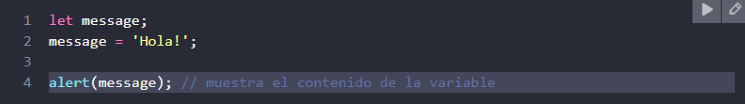

Pero por el bien de la legibilidad se recomienda una línea por variable:

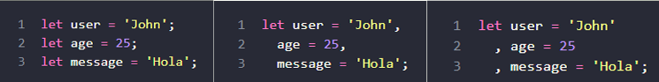

**NOTA: En scripts más viejos se puede encontrar la palabra clave VAR en lugar de LET.**

---


Ejemplo de cómo mover el contenido de variables entre las mismas:

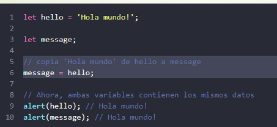

### Nombramiento de variables

Existen dos limitaciones de nombre de variables en JavaScript:

a. El nombre únicamente puede incluir letras, dígitos, o los símbolos \$ y \_.

b. El primer carácter no puede ser un dígito.


**NOTA1: Es interesante notar que el símbolo del dólar '\$' y el guion bajo '\_' también se utilizan en nombres. Son símbolos comunes, tal como las letras, sin ningún significado especial.**
**NOTA2: Dos variables con nombres manzana y MANZANA son variables distintas.**

Hay una lista de palabras reservadas, las cuales no pueden ser utilizadas como nombre de variable porque el lenguaje en sí las utiliza. Por ejemplo: **let, class, return, y function** están reservadas.

---

### Constantes
Para declarar una variable constante (inmutable) usa "**const"** en vez de "let**"**. Las variables declaradas utilizando **const** se llaman "constantes". No pueden ser alteradas. Al intentarlo causaría un error:

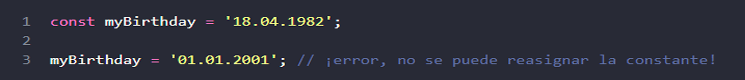

**Constantes Mayúsculas**

Existe una práctica utilizada ampliamente de utilizar constantes como aliases de valores difícilesde-recordar y que se conocen previo a la ejecución. Tales constantes se nombran utilizando letras mayúsculas y guiones bajos.

Por ejemplo, creemos constantes para los colores en el formato "web" (hexadecimal):

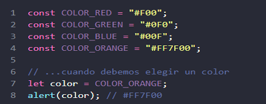

---

Ventajas:

- 1. COLOR\_ORANGE es mucho más fácil de recordar que "#FF7F00".
- 2. Es mucho más fácil escribir mal "#FF7F00" que COLOR\_ORANGE.

Al leer el código, COLOR\_ORANGE tiene mucho más significado que #FF7F00.

---

# RESUMEN

 * Podemos declarar variables para almacenar datos al utilizar las palabras clave var, let, o const. 
 * let – es la forma moderna de declaración de una variable. 
 * var – es la declaración de variable de vieja escuela. Normalmente no lo utilizamos en absoluto. Cubriremos sus sutiles diferencias con let en el capítulo La vieja "var", por si lo necesitaras.
 * const – es como let, pero el valor de la variable no puede ser alterado.

---

## TAREAS

**1. Trabajando con variables** Declara dos variables: admin y name. Asigna el valor "Javier" a name. Copia el valor de name a admin. Muestra el valor de admin usando alert.

**2. Dando el nombre correcto**

Crea una variable con el nombre de nuestro planeta. ¿Cómo nombrarías a dicha variable? Crea una variable para almacenar el nombre del usuario actual de un sitio web. ¿Cómo nombrarías a dicha variable?


**3. Constantes Mayúsculas**

Examina el siguiente código: 

```
const birthday = '18.04.1986';
const age = someCode(birthday); 
```

 Aquí tenemos una constante birthday para la fecha de cumpleaños, y la edad age, que también es constante.
 * age es calculada desde birthday con la ayuda de "cierto código" someCode(), que es una llamada a función que no hemos explicado aún (¡lo haremos pronto!); los detalles no importan aquí, el punto es que age se calcula de alguna forma basándose en birthday. 

 
 ¿Sería correcto usar mayúsculas en birthday? ¿Y en age? ¿O en ambos?
 
 ```
  const BIRTHDAY = '18.04.1982'; // ¿birthday en mayúsculas? const AGE = someCode(BIRTHDAY); // ¿age en mayúsculas?
 ```

---

###  Constantes

Para declarar una variable constante (inmutable) usa "**const"** en vez de "let**"**. Las variables declaradas utilizando **const** se llaman "constantes". No pueden ser alteradas. Al intentarlo causaría un error:

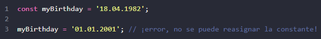


**Constantes Mayúsculas**

Existe una práctica utilizada ampliamente de utilizar constantes como aliases de valores difícilesde-recordar y que se conocen previo a la ejecución. Tales constantes se nombran utilizando letras mayúsculas y guiones bajos.

Por ejemplo, creemos constantes para los colores en el formato "web" (hexadecimal):

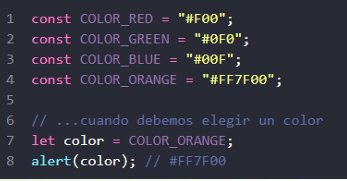

---

## Ventajas:

- COLOR\_ORANGE es mucho más fácil de recordar que "#FF7F00".
- Es mucho más fácil escribir mal "#FF7F00" que COLOR\_ORANGE.

---
# RESUMEN

 * Podemos declarar variables para almacenar datos al utilizar las palabras clave var, let, o const.
 * let – es la forma moderna de declaración de una variable.
 * var – es la declaración de variable de vieja escuela. Normalmente no lo utilizamos en absoluto. Cubriremos sus sutiles diferencias con let en el capítulo La vieja "var", por si lo necesitaras. 
 * const – es como let, pero el valor de la variable no puede ser alterado.

---

## Tipos de datos

### *NUMBER*

El tipo number representa tanto números enteros como de punto flotante. Hay muchas operaciones para números. Por ejemplo, multiplicación \*, división /, suma +, resta -, y demás.

Además de los números comunes, existen los llamados "valores numéricos especiales" que también pertenecen a este tipo de datos: Infinity, -Infinity y NaN.

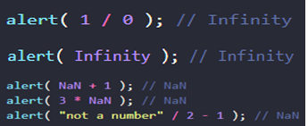

**NOTA: Por lo tanto, si hay un NaN en alguna parte de una expresión matemática, se propaga a todo el resultado (con una única excepción: NaN \*\* 0 es 1).**

---

### *BIGINT*

En JavaScript, el tipo "number" no puede representar de forma segura valores enteros mayores que (253-1) (eso es 9007199254740991), o menor que -(253-1) para negativos.

Un valor BigInt se crea agregando n al final de un entero:

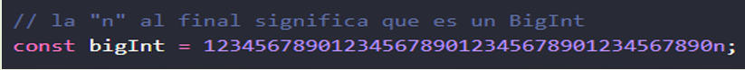


**NOTA: Problemas de compatibilidad** → **En este momento, BigInt está soportado por Firefox/Chrome/Edge/Safari, pero no por IE.**

---

### *STRING*

Un string en JavaScript es una cadena de caracteres y debe colocarse entre comillas. En JavaScript, hay 3 tipos de comillas.

a. Comillas dobles: "Hola".
b. Comillas simples: 'Hola'.
c. Backticks (comillas invertidas): `Hola`.

Las comillas dobles y simples son comillas "sencillas" (es decir, funcionan igual). No hay diferencia entre ellas en JavaScript.

Los backticks son comillas de "funcionalidad extendida". Nos permiten incrustar variables y expresiones en una cadena de caracteres encerrándolas en \${...}, por ejemplo:


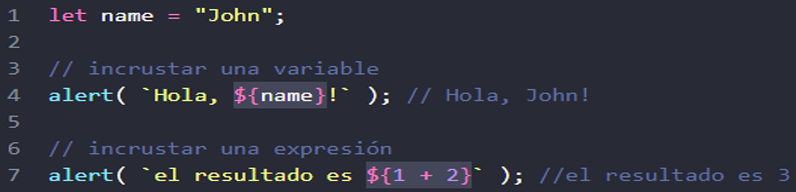

---

### *BOOLEAN (TIPO LÓGICO)*

El tipo boolean tiene sólo dos valores posibles: true y false.

Este tipo se utiliza comúnmente para almacenar valores de sí/no: true significa "sí, correcto, verdadero", y false significa "no, incorrecto, falso".

Por ejemplo:

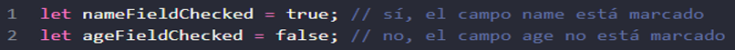

### *VALOR "NULL" (NULO)*

El valor especial null no pertenece a ninguno de los tipos descritos anteriormente. Forma un tipo propio separado que contiene sólo el valor null:

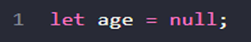

En JavaScript, null no es una "referencia a un objeto inexistente" o un "puntero nulo" como en otros lenguajes. Es sólo un valor especial que representa "nada", "vacío" o "valor desconocido".

---

### *VALOR UNDEFINED*

El valor especial undefined también se distingue. Hace un tipo propio, igual que null. El significado de undefined es "valor no asignado".

Si una variable es declarada, pero no asignada, entonces su valor es undefined, es posible asignar undefined a cualquier variable:


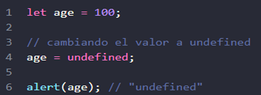

**NOTA: Normalmente, usamos null para asignar un valor "vacío" o "desconocido" a una variable, mientras undefined es un valor inicial reservado para cosas que no han sido asignadas**.

---

## ¿Cuándo muestra `alert()` la palabra "undefined"?

Cualquier función `alert()` y cualquier `console.log()` realizan una acción visual pero **devuelven siempre `undefined`** por debajo.

Por lo tanto, verás una ventana de alerta que dice **`undefined`** cuando hagas un `alert` de algo que devuelva `undefined`, como por ejemplo:

1. Un `alert` dentro de otro `alert`:
   alert( alert(1) );
   // ¿Qué pasa? 
   // - Primero salta la alerta "1". 
   // - Al cerrarla, el alert(1) devuelve 'undefined'.
   // - El alert de fuera recibe ese 'undefined' y muestra una ventana que dice: "undefined".

2. Un `alert` de un `console.log`:
   alert( console.log("Hola") );
   // ¿Qué pasa? 
   // - Primero se imprime "Hola" en la consola del navegador. 
   // - Como console.log() también devuelve 'undefined', el alert exterior lo recibe.
   // - Salta una ventana de alerta que dice: "undefined".

   * SE VERÁN EJEMPLOS EN LOS OPERADORES LÓGICOS

---

### *EL OPERADOR TYPEOF*

El operador typeof devuelve el tipo de dato del operando. Es útil cuando queremos procesar valores de diferentes tipos de forma diferente o simplemente queremos hacer una comprobación rápida. La llamada a typeof x devuelve una cadena con el nombre del tipo:
<table>
<td>

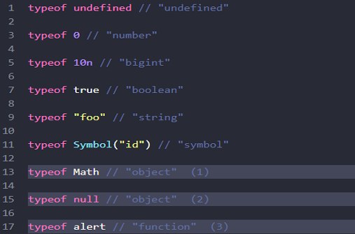

</td>
<td>
Las últimas tres líneas pueden necesitar una explicación adicional:

- a) **Math** es un objeto incorporado que proporciona operaciones matemáticas. Lo aprenderemos en el capítulo Números. Aquí sólo sirve como ejemplo de un objeto.
- b) El resultado de **typeof null** es "object". Esto está oficialmente reconocido como un error de comportamiento de typeof que proviene de los primeros días de JavaScript y se mantiene por compatibilidad.
- c) El resultado de **typeof alert** es "function" porque alert es una función. Las funciones pertenecen al tipo objeto. Pero typeof las trata de manera diferente, devolviendo function.

</td>
</table>

---

# RESUMEN

* Hay 8 tipos básicos en JavaScript. 
* Siete tipos de datos primitivos
  - number para números de cualquier tipo: enteros o de punto flotante, los enteros están limitados por ±(2<sup>53</sup>-1). 
  - bigint para números enteros de longitud arbitraria. 
  - string para cadenas. Una cadena puede tener cero o más caracteres, no hay un tipo especial para un único carácter. 
  - boolean para verdadero y falso: true/false. 
  - null para valores desconocidos – un tipo independiente que tiene un solo valor nulo: null.
  - undefined para valores no asignados – un tipo independiente que tiene un único valor "indefinido": undefined. 
  - symbol para identificadores únicos. 
* Y un tipo de dato no primitivo: 
  - object para estructuras de datos complejas.
* El operador typeof nos permite ver qué tipo está almacenado en una variable. 
  - Dos formas: typeof x o typeof(x). Devuelve una cadena con el nombre del tipo. Por ejemplo "string". Para null devuelve "object": esto es un error en el lenguaje, en realidad no es un objeto.

---

## TAREAS EN CLASE

¿Cuál es la salida del script?

```
let name = "Ilya";

alert( `Hola \${1}` ); // ?

alert( `Hola \${"name"}` ); // ?

alert( `Hola \${name}` ); // ?

```
---

#  Conversiones de tipo

La mayoría de las veces, los operadores y funciones convierten automáticamente los valores que se les pasan al tipo correcto. Esto es llamado "conversión de tipo".

Por ejemplo, **alert** convierte automáticamente cualquier valor a string para mostrarlo. Las operaciones matemáticas convierten los valores a números. También hay casos donde necesitamos convertir de manera explícita un valor al tipo esperado.

### *ToString*

La conversión a string ocurre cuando necesitamos la representación en forma de texto de un valor. Por ejemplo, alert(value) lo hace para mostrar el valor como texto. También podemos llamar a la función String(value) para convertir un valor a string:

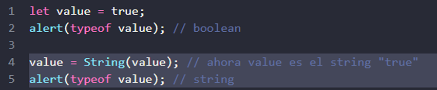

---

### *ToNumber*

La conversión numérica ocurre automáticamente en funciones matemáticas y expresiones. Por ejemplo, cuando se dividen valores no numéricos usando /:


Podemos usar la función Number(value) para convertir de forma explícita un valor a un número:

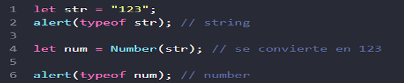


Si el string no es un número válido, el resultado de la conversión será NaN. Por ejemplo:

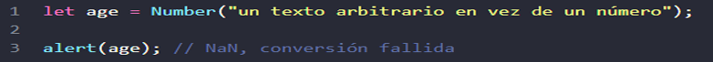

---

Reglas de conversión numérica:

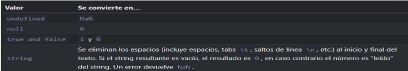

Ejemplos:

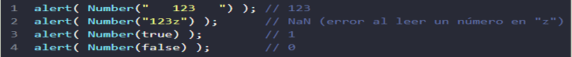

**NOTA: Ten en cuenta que null y undefined se comportan de distinta manera aquí: null se convierte en 0 mientras que undefined se convierte en NaN.**


---

### ToBoolean

Ocurre en operaciones lógicas (más adelante veremos test condicionales y otras cosas similares), pero también puede realizarse de forma explícita llamando a la función Boolean(value).

Las reglas de conversión:

- Los valores que son intuitivamente "vacíos", como 0, "", null, undefined, y NaN, se convierten en false.
- Otros valores se convierten en true.

Por ejemplo:

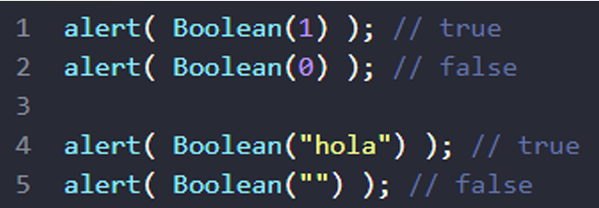

**NOTA: En JavaScript, un string no vacío es siempre true.**

---

# RESUMEN

 * Las tres conversiones de tipo más usadas son a string, a número y a boolean. 
 * **ToString** – Ocurre cuando se muestra algo. Se puede realizar con String(value). La conversión a string es usualmente obvia para los valores primitivos. 
 * **ToNumber** – Ocurre en operaciones matemáticas. Se puede realizar con Number(value).
 * **ToBoolean** – Ocurren en operaciones lógicas. Se puede realizar con Boolean(value). La mayoría de estas reglas son fáciles de entender y recordar. Las excepciones más notables donde la gente suele cometer errores son: 
  - undefined es NaN como número, no 0. 
  - "0" y textos que solo contienen espacios como " " son true como boolean.

 ---

# Operadores básicos

Se van a revisar los siguientes términos: "unario", "binario", "operando"

- Un operando es a lo que se aplican los operadores. Por ejemplo, en la multiplicación de 5 \* 2 hay dos operandos: el operando izquierdo es 5 y el operando derecho es 2. A veces, la gente los llama "argumentos" en lugar de "operandos".
- Un operador es unario si tiene un solo operando. Por ejemplo, la negación unaria invierte el signo de un número:

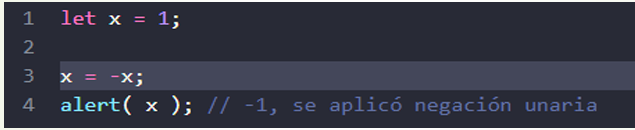
- Un operador es binario si tiene dos operandos. El mismo negativo también existe en forma binaria:

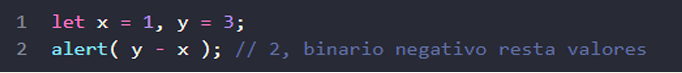

---

Están soportadas las siguientes operaciones:

1. Suma "+"
2. Resta "-"
3. Multiplicación "\*"
4. División "/"
5. Resto "%"
6. Exponenciación "\*\*"

Se explicarán más ampliamente los 2 últimos operandos.


---

### *1. Resto %*

El operador resto %, a pesar de su apariencia, no está relacionado con porcentajes. El resultado de a % b es el resto de la división entera de a por b. Por ejemplo:

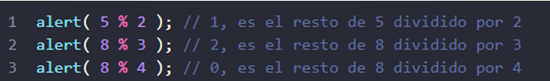

### *2. Exponenciación \*\**

El operador exponenciación a \*\* b eleva a a la potencia de b. Por ejemplo:

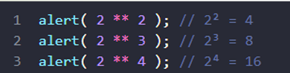

Por ejemplo, la raíz cuadrada es el exponente ½:

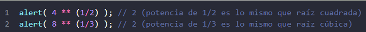


---
Se van a revisar las características de los operadores de JavaScript.


### *Concatenación de cadenas con el binario*

Si se aplica el + binario a una cadena, los une (concatena):

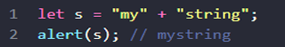


A tener en cuenta, que si uno de los operandos es una cadena, el otro es convertido a una cadena también.
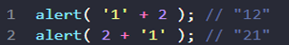


Aquí hay un ejemplo algo más complejo:
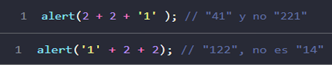


Aquí el primer operando es una cadena, el compilador trata los otros dos operandos como cadenas también. El 2 es concatenado a '1', entonces es como '1' + 2 = "12" y "12" + 2 = "122".

El binario + es el único operador que soporta cadenas en esa forma. Otros operadores matemáticos trabajan solamente con números y siempre convierten sus operandos a números.

---

### *Conversión numérica, unario "+"*

La suma + existe en dos formas: la forma binaria que utilizamos arriba y la forma unaria. El unario suma o, en otras palabras, el operador suma + aplicado a un solo valor, no hace nada a los números. Pero si el operando no es un número, el unario suma lo convierte en un número. Por ejemplo:

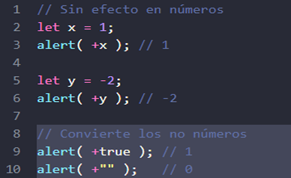

El operador binario suma los agregaría como cadenas:

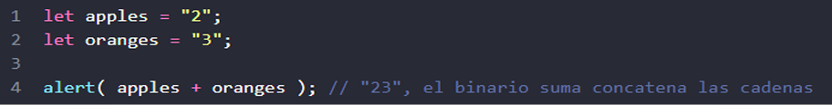

---

Si queremos tratarlos como números, necesitamos convertirlos y luego sumarlos:

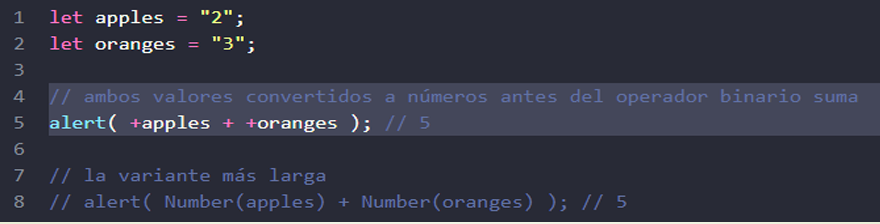


---

### *Precedencia del operador*

Si una expresión tiene más de un operador, el orden de ejecución se define por su precedencia o, en otras palabras, el orden de prioridad predeterminado de los operadores. Los paréntesis anulan cualquier precedencia, por lo que si no estamos satisfechos con el orden predeterminado, podemos usarlos para cambiarlo. Por ejemplo, escriba (1 + 2) \* 2.

Hay muchos operadores en JavaScript. Cada operador tiene un número de precedencia correspondiente. El que tiene el número más grande se ejecuta primero. Si la precedencia es la misma, el orden de ejecución es de izquierda a derecha.

Aquí hay un extracto de la tabla de precedencia (no necesita recordar esto, pero tenga en cuenta que los operadores unarios son más altos que el operador binario correspondiente):

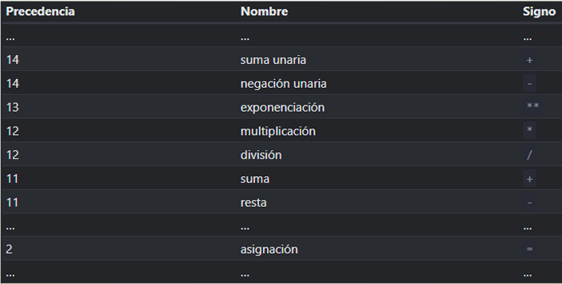

---

### *Asignación*

Tener en cuenta que una asignación "=" también es un operador. Está listado en la tabla de precedencia con una prioridad muy baja de 2. Es por eso que, cuando asignamos una variable, como x = 2 \* 2 + 1, los cálculos se realizan primero y luego se evalúa el =, almacenando el resultado en x.

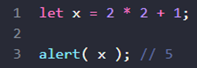

*Asignación = devuelve un valor*

Todos los operadores en JavaScript devuelven un valor. Esto es obvio para + y -, pero también es cierto para =. La llamada **x = value** escribe el value en x y luego lo devuelve.

Aquí hay una demostración que usa una asignación como parte de una expresión más compleja:

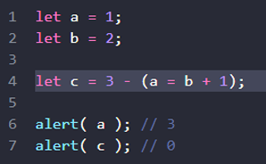

---

###  *Asignaciones encadenadas*

Otra característica interesante es la habilidad para encadenar asignaciones:

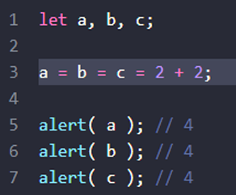


Las asignaciones encadenadas evalúan de derecha a izquierda. Primero, se evalúa la expresión más a la derecha 2 + 2 y luego se asigna a las variables de la izquierda: c, b y a. Al final, todas las variables comparten un solo valor. Una vez más, con el propósito de la legibilidad es mejor separa tal código en unas pocas líneas.

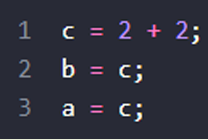

---

### *Modificar en el lugar*

A menudo necesitamos aplicar un operador a una variable y guardar el nuevo resultado en esa misma variable. Por ejemplo:

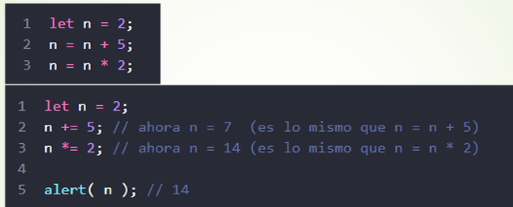

\* Esta notación puede ser acortada utilizando los operadores += y \*=:

Los operadores cortos "modifica y asigna" existen para todos los operadores aritméticos y de nivel bit: /=, -=, etcétera. Tales operadores tienen la misma precedencia que la asignación normal, por lo tanto se ejecutan después de otros cálculos:

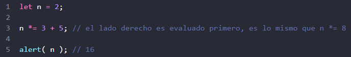

---

### *Incremento/Decremento*

Aumentar o disminuir un número en uno es una de las operaciones numéricas más comunes. Entonces, hay operadores especiales para ello:

#### <sup>o</sup> Incremento ++ incrementa una variable por 1:
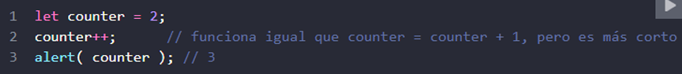


#### <sup>o</sup> Decremento -- decrementa una variable por 1:

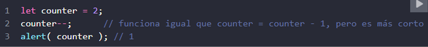

---

Los operadores ++ y -- pueden ser colocados antes o después de una variable.

<sup>o</sup> Cuando el operador va después de la variable, está en "forma de sufijo": counter++.
<sup>o</sup> La "forma de prefijo" es cuando el operador va antes de la variable: ++counter. Ambas sentencias hacen la misma cosa: aumentar counter por 1.

Todos los operadores devuelven un valor, Incremento/decremento no es una excepción. La forma prefijo devuelve el nuevo valor mientras que la forma sufijo devuelve el valor anterior (antes del incremento/decremento). Para ver la diferencia, aquí hay un ejemplo:

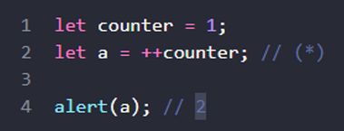

En la línea (\*), la forma prefijo **++counter** incrementa *counter* y devuelve el nuevo valor,


2. Por lo tanto, el alert muestra 2. Ahora usemos la forma sufijo:
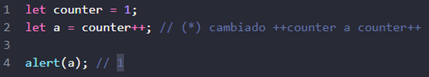


En la línea (\*), la forma sufijo **counter++** también incrementa *counter*, pero devuelve el antiguo valor (antes de incrementar). Por lo tanto, el alert muestra 1.

---

Para resumir:

* Si no se usa el resultado del incremento/decremento, no hay diferencia en la forma de usar:

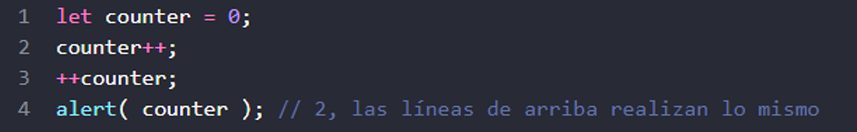

* Si queremos aumentar un valor y usar inmediatamente el resultado del operador, necesitamos la forma de prefijo:

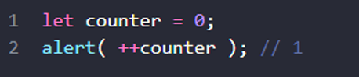


* Si queremos incrementar un valor, pero usamos su valor anterior, necesitamos la forma sufijo:

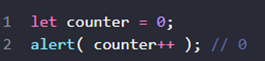

---

### *Operadores a nivel de BIT*

Los operadores a nivel bit tratan los argumentos como números enteros de 32 bits y trabajan en el nivel de su representación binaria. Estos operadores no son específicos de JavaScript. Son compatibles con la mayoría de los lenguajes de programación. La lista de operadores:

<sup>o</sup> AND ( & ) <sup>o</sup> OR ( | ) 
<sup>o</sup> XOR ( ^ ) 
<sup>o</sup> NOT ( ~ ) 
<sup>o</sup> LEFT SHIFT ( << ) <sup>o</sup> RIGHT SHIFT ( >> )
<sup>o</sup> ZERO-FILL RIGHT SHIFT ( >>> )

---

### *Coma*

El operador coma "," es uno de los operadores más raros e inusuales. A veces, es utilizado para escribir código más corto. El operador coma nos permite evaluar varias expresiones, dividiéndolas con una coma ",". Cada una de ellas es evaluada, pero sólo el resultado de la última es devuelto. Por ejemplo:

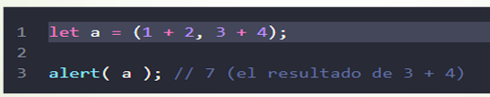

Aquí, se evalúa la primera expresión 1 + 2 y se desecha su resultado. Luego, se evalúa 3 + 4 y se devuelve como resultado.

**NOTA: Tenga en cuenta que el operador coma tiene una precedencia muy baja, inferior a =, por lo que los paréntesis son importantes en el ejemplo anterior. Sin ellos: a = 1 + 2, 3 + 4 se evalúa primero el +, sumando los números "a" a = 3, 7, luego el operador de asignación "=" asigna a = 3, y el resto es ignorado. Es igual que (a = 1 + 2), 3 + 4.**

---

# TAREAS

## Las formas sufijo y prefijo

**¿Cuáles son los valores finales de todas las variables a, b, c y d después del código a continuación?**

 let a = 1, b = 1; 
 let c = ++a; // ? 
 let d = b++; // ?
 
## Resultado de asignación

¿Cuáles son los valores de 'a' y 'x' después del código a continuación?

1 let a = 2;
2 let x = 1 + (a \*= 2); 

---

## Conversiones de tipos

**¿Cuáles son los resultados de estas expresiones?**

```
"" + 1 + 0 = "10"
"" - 1 + 0 = -1
true + false = 1
6 / "3" = 2
"2" * "3" = 6
4 + 5 + "px" = "9px"
"$" + 4 + 5 = "$45"
"4" - 2 = 2
"4px" - 2 = NaN
" -9 " + 5 = " -9 5"
" -9 " - 5 = -14
null + 1 = 1
undefined + 1 = NaN
" \t \n" - 2 = -2
```
Piensa bien, anótalos y luego compara con la respuesta.

---

## SOLUCIÓN
```
"" + 1 + 0 -> "10"
"" - 1 + 0 -> -1
true + false -> 1
6 / "3" -> 2
"2" * "3" -> 6
4 + 5 + "px" -> "9px"
"$" + 4 + 5 -> "$45"
"4" - 2 -> 2
"4px" - 2 -> NaN
" -9 " + 5 -> " -9 5"
" -9 " - 5 -> -14
null + 1 -> 1
undefined + 1 -> NaN
" \t \n" - 2 -> -2

```

---

## Corregir la adición

Aquí hay un código que le pide al usuario dos números y muestra su suma.

Funciona incorrectamente. El resultado en el ejemplo a continuación es <sup>12</sup> (para valores de captura predeterminados).

¿Por qué? Arréglalo. El resultado debería ser <sup>3</sup>.

```
let a = Number(prompt("¿Primer número?", 1));
let b = Number(prompt("¿Segundo número?", 2));

alert(a + b); // 3 (Suma matemática correcta)

 ```

 ---

## ¿Por qué funciona incorrectamente?
Funciona mal porque la función prompt() siempre devuelve un texto (un string), sin importar que el usuario escriba números.

Por lo tanto, las variables a y b guardan los valores "1" y "2" como textos. Cuando utilizas el operador + con cadenas de texto, JavaScript no realiza una suma matemática, sino una concatenación (une ambos textos), dando como resultado "12" en lugar de 3.

## ¿Cómo arreglarlo?

Para que el resultado sea 3, debes convertir los textos introducidos en números antes de sumarlos, utilizando Number() o el operador +:

```
let a = Number(prompt("¿Primer número?", 1));
let b = Number(prompt("¿Segundo número?", 2));

alert(a + b); // 3

```
O

```
let a = +prompt("¿Primer número?", 1);
let b = +prompt("¿Segundo número?", 2);

alert(a + b); // 3
```

 ---

## Comparaciones

En Javascript se escriben así:

o Mayor/menor que: a > b, a < b. 
o Mayor/menor o igual que: a >= b, a <= b. 
o Igual: a == b (ten en cuenta que el doble signo == significa comparación, mientras que un solo símbolo a = b significaría una asignación).
o Distinto. En matemáticas la notación es ≠, pero en JavaScript se escribe como una asignación con un signo de exclamación delante: a != b.

---

## Booleano es el resultado

Como todos los demás operadores, una comparación retorna un valor. En este caso, el valor es un booleano.

o true – significa "sí", "correcto" o "verdad". o false – significa "no", "equivocado" o " no verdad".

Por ejemplo:

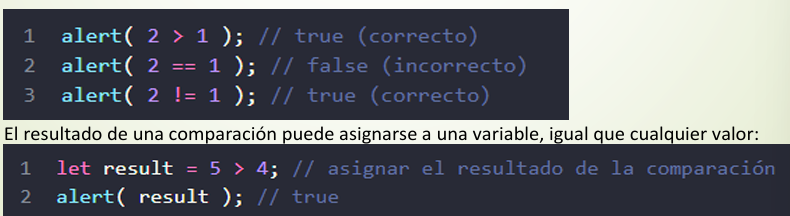

El resultado de una comparación puede asignarse a una variable, igual que cualquier valor:


---
## Comparación de cadenas

Para ver si una cadena es "mayor" que otra, JavaScript utiliza el llamado orden "de diccionario" o "lexicográfico". En otras palabras, las cadenas se comparan letra por letra. Por ejemplo:

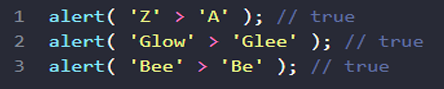

El algoritmo para comparar dos cadenas es simple:

1) Compare el primer carácter de ambas cadenas.
2) Si el primer carácter de la primera cadena es mayor (o menor) que el de la otra cadena, entonces la primera cadena es mayor (o menor) que la segunda. Hemos terminado.
3) De lo contrario, si los primeros caracteres de ambas cadenas son los mismos, compare los segundos caracteres de la misma manera.
4) Repita hasta el final de cada cadena.
5) Si ambas cadenas tienen la misma longitud, entonces son iguales. De lo contrario, la cadena más larga es mayor.

---

En los ejemplos anteriores, la comparación 'Z' > 'A' llega a un resultado en el primer paso. La segunda comparación "Glow" y "Glee" necesitan más pasos, se comparan carácter por carácter:

1) G es igual que G.
2) l es igual que l.
3) es mayor que e. Detente aquí. La primera cadena es mayor.


**NOTA: Por ejemplo, las mayúsculas importan. Una letra mayúscula "A" no es igual a la minúscula "a". ¿Cuál es mayor? La "a" minúscula. ¿Por qué? Porque el carácter en minúsculas tiene un mayor índice en la tabla de codificación interna que utiliza JavaScript (Unicode).**


---

**Comparación de diferentes tipos** 

Al comparar valores de diferentes tipos, JavaScript convierte los valores a números. Por 
ejemplo: 

 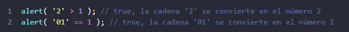

Para valores booleanos, true se convierte en 1 y false en 0. Por ejemplo: 

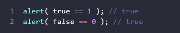
 
**Igualdad estricta**

Una comparación regular de igualdad == tiene un problema. No puede diferenciar 0 de `falso’: 
 


Lo mismo sucede con una cadena vacía: 


---

Esto sucede porque los operandos de diferentes tipos son convertidos a números por el operador de igualdad “==”. Una cadena vacía, al igual que false, se convierte en un cero. 

¿Qué hacer si queremos diferenciar 0 de false? Un operador de igualdad estricto “===” comprueba la igualdad sin conversión de tipo. En otras palabras, si a y b son de diferentes tipos, entonces a === b retorna inmediatamente false sin intentar convertirlos. 

Intentémoslo: 


Existe también un operador de diferencia estricta “!==” análogo a “!=”. 

---

**Comparación con nulos e indefinidos**
Hay un comportamiento no intuitivo cuando se compara null o undefined con otros valores.
Para un control de igualdad estricto “===”. Estos valores son diferentes, porque cada uno de ellos es de un tipo diferente. 


 
Para una comparación no estricta == 
Hay una regla especial. Estos dos son una " pareja dulce ": son iguales entre sí (en el sentido de ==), pero no a ningún otro valor. 


 
 
**Resultados extraños: NULL vs 0**

Comparemos null con un cero: 
 
 
La razón es que una comparación de igualdad == y las comparaciones > < >= <= funcionan de manera diferente. Las comparaciones convierten a null en un número, tratándolo como 0. Es por eso que (3) null >= 0 es verdadero y (1) null > 0 es falso.  
Por otro lado, el control de igualdad == para undefined y null se define de tal manera que, sin ninguna conversión, son iguales entre sí y no son iguales a nada más. Es por eso que (2) null == 0 es falso. 

---

**Un indefinido incomparable**
El valor undefined no debe compararse con otros valores: 
 

 

Obtenemos estos resultados porque: 
• Las comparaciones (1) y (2) retornan falso porque no definido se convierte en NaN y NaN es un valor numérico especial que retorna falso para todas las comparaciones. 
• La comparación de igualdad (3) retorna falso porque undefined sólo equivale a null y a ningún otro valor. 


---

# RESUMEN
* Los operadores de comparación retornan un valor booleano.
* Las cadenas se comparan letra por letra en el orden del “diccionario”.
* Cuando se comparan valores de diferentes tipos, se convierten en números (excepto un control de igualdad estricta).
* Los valores null y undefined son iguales == entre sí y no equivalen a ningún otro valor.
* Ten cuidado al usar comparaciones como > o < con variables que ocasionalmente pueden ser null/undefined. Revisar por separado si hay null/undefined es una buena idea.

---

# TAREAS

## Comparaciones 

¿Cuál será el resultado de las siguientes expresiones? 
```
5 > 4 
"apple" > "pineapple" 
"2" > "12" 
undefined == null 
undefined === null 
null == "\n0\n" 
null === +"\n0\n" 
```
---
## RESULTADO
```
5 > 4 -> true
"apple" > "pineapple" -> false
"2" > "12" -> true
undefined == null -> true
undefined === null -> false
null == "\n0\n" -> false
null === +"\n0\n" -> false
````

---


## EJECUCION CONDICIONAL

A veces necesitamos que, bajo condiciones diferentes, se ejecuten acciones diferentes. Para esto podemos usar la sentencia if y el “operador condicional” ?. 

### Sentencia “if”
La sentencia if(...) evalúa la condición en los paréntesis, y si el resultado es verdadero (true), ejecuta un bloque de código. Por ejemplo: 


Aquí la condición es una simple igualdad (year == 2015), pero podría ser mucho más compleja. Si queremos ejecutar más de una sentencia, debemos encerrar nuestro bloque de código entre llaves:  

Recomendamos encerrar nuestro bloque de código entre llaves {} siempre que se utilice la sentencia if, incluso si solo se va a ejecutar una sola sentencia. Al hacerlo mejoramos la legibilidad. 

---


### Conversión Booleana 
La sentencia if (…) evalúa la expresión dentro de sus paréntesis y convierte el resultado en booleano. Recordemos las reglas de conversión del capítulo Conversiones de Tipos: 
• El número 0, un string vacío "", null, undefined, y NaN, se convierten en false. Por esto son llamados valores “falsos”. 
• El resto de los valores se convierten en true, entonces los llamaremos valores “verdaderos”. 

Se puede pasar un valor booleano pre-evaluado al if, así: 


---

### La cláusula “else” 
La sentencia if puede contener un bloque else (“si no”, “en caso contrario”) opcional. Este bloque se ejecutará cuando la condición sea falsa. Por ejemplo: 

 

---

### Muchas condiciones “else if” 
A veces se quiere comprobar más de una condición. La cláusula else if nos permite anidar varios condicionantes. Por ejemplo: 


En el código de arriba, JavaScript primero revisa si year < 2015. Si esto es falso, continúa a la siguiente condición year > 2015. Si esta también es falsa, mostrará la última alert. Podría haber más bloques else if. Y el último else es opcional. 


---

### Operador ternario “?” 
A veces necesitamos que el valor que asignemos a una variable dependa de alguna condición. Por ejemplo: 


 
El “operador condicional” nos permite ejecutar esto en una forma más corta y simple. El operador está representado por el signo de cierre de interrogación “?”. A veces es llamado “ternario” porque el operador tiene tres operandos, es el único operador de JavaScript que tiene esa cantidad. La Sintaxis es: 
 


---

Se evalúa condition: si es verdadera entonces devuelve value1 , de lo contrario value2. Por ejemplo: 
 

 
 
Técnicamente, podemos omitir el paréntesis alrededor de age > 18. El operador de signo de interrogación tiene una precedencia baja, por lo que se ejecuta después de la comparación >. En este ejemplo realizaremos lo mismo que en el anterior: 


NOTA: En el ejemplo de arriba, podrías evitar utilizar el operador de signo de interrogación porque esta comparación devuelve directamente true/false. 


---

### Múltiples 
Una secuencia de operadores de signos de interrogación “?” puede devolver un valor que depende de más de una condición. Por ejemplo: 
 


Puede ser difícil al principio comprender lo que está sucediendo. Pero después de una mirada más cercana, podemos ver que es solo una secuencia ordinaria de condiciones: 
1) El primer signo de pregunta revisa si age < 3. 
2) Si es cierto, devuelve '¡Hola, bebé!'. De lo contrario, continúa a la expresión que está después de los dos puntos “:”, la cual revisa si age < 18. 
3) Si es cierto, devuelve '¡Hola!'. De lo contrario, continúa con la expresión que está después de los dos puntos siguientes “:”, la cual revisa si age < 100. 

---

4) Si es cierto, devuelve '¡Felicidades!'. De lo contrario, continúa a la expresión que está después de los dos puntos “:”, la cual devuelve '¡Qué edad tan inusual!'. Aquí lo podemos ver utilizando if..else: 


A veces, el signo de interrogación de cierre “?” se utiliza para reemplazar un if: 


---
 
Dependiendo de la condición company == 'Netscape', se ejecutará la primera o la segunda expresión del operador “?” y se mostrará una alerta. Aquí no asignamos el resultado a una variable. En vez de esto, ejecutamos diferentes códigos dependiendo de la condición. 

La notación es más corta que la sentencia equivalente con “if”, lo cual seduce a algunos programadores. Pero es menos legible. Aquí está el mismo código utilizando la sentencia if para comparar: 
 


Los bloques de código que se expanden múltiples líneas son más fáciles de entender que los las instrucciones largas horizontales. El propósito del operador de signo de interrogación “?” es para devolver un valor u otro dependiendo de su condición. 

Por favor utilízala para exactamente esto. Utiliza la sentencia “if” cuando necesites ejecutar código en ramas distintas. 

---


# TAREAS

<table>
<td>

**if (un string con cero)**

Se mostrará el alert? 
```
if ("0") { 
 alert( 'Hello' ); 
} 
```
</td>
<td>

**El nombre de JavaScript**
Usando el constructor if..else, escribe el código que pregunta: ‘¿Cuál es el nombre “oficial” de JavaScript?’ 
Si el visitante escribe “ECMAScript”, entonces muestra: “¡Correcto!”, de lo contrario muestra: “¿No lo sabes? ¡ECMAScript!”  

 

Demo en nueva ventana : https://es.js.cx/task/check-standard/ifelse_task2

</td>

</table>

---

**Muestra el signo**
Usando el constructor if..else, escribe un código que obtenga a través de un prompt un número y entonces muestre en un alert: 

```
1, si el valor es mayor que cero, 
-1, si es menor que cero, 
0, si es igual a cero. 
```  
En la tarea asumimos que siempre el usuario introduce un número. 


Demo en nueva ventana: 
https://es.js.cx/task/sign/if_sign

---
**Reescribe el 'if..else' con '?'**

Reescribe el if..else utilizando operadores ternarios múltiples'?'. 
Para legibilidad, es recomendad dividirlo en múltiples lineas de código. 

```
let message; 
if (login == 'Empleado') { 
 message = 'Hola'; 
} else if (login == 'Director') { 
 message = 'Felicidades'; 
} else if (login == '') { 
 message = 'Sin sesión'; 
} else { message = '';} 
```
---
## Operadores Lógicos

Hay cuatro operadores lógicos en JavaScript: || (O), && (Y), ! (NO), ?? (Fusión de nulos). Aunque sean llamados lógicos, pueden ser aplicados a valores de cualquier tipo, no solo booleanos. El resultado también puede ser de cualquier tipo.

### || (OR)

 El operador OR se representa con dos símbolos de linea vertical: 
 

 
En la programación clásica, el OR lógico está pensado para manipular solo valores booleanos. Si cualquiera de sus argumentos es true, retorna true, de lo contrario retorna false. En JavaScript, el operador es un poco más complicado y poderoso. Pero primero, veamos qué pasa con los valores booleanos. Hay cuatro combinaciones lógicas posibles: 


 

 ---

Como podemos ver, el resultado es siempre true excepto cuando ambos operandos son false. Si un operando no es un booleano, se lo convierte a booleano para la evaluación. Por ejemplo, el número 1 es tratado como true, el número 0 como false: 
 


La mayoría de las veces, OR || es usado en una declaración if para probar si alguna de las condiciones dadas es true. Por ejemplo: 
  


Podemos pasar más condiciones: 
 


---


## || (OR) encuentra el primer valor verdadero 

La lógica descrita arriba es algo clásica. Ahora, mostremos las características “extra” de JavaScript. El algoritmo extendido trabaja de la siguiente forma. Dado múltiples valores aplicados al operador OR: 


 
El operador OR || realiza lo siguiente: 
• Evalúa los operandos de izquierda a derecha. 
• Para cada operando, convierte el valor a booleano. Si el resultado es true, se detiene y retorna el valor original de ese operando. 
• Si todos los operandos han sido evaluados (todos eran false), retorna el ultimo operando. 

Un valor es retornado en su forma original, sin la conversión. En otras palabras, una cadenade OR "||" devuelve el primer valor verdadero o el último si ningún verdadero es encontrado. Por ejemplo: 


---

Esto brinda varios usos interesantes comparados al “OR puro, clásico, de solo booleanos”.  

**1)** Obtener el primer valor verdadero de una lista de variables o expresiones. Por ejemplo, tenemos las variables firstName, lastName y nickName, todas opcionales (pueden ser undefined o tener valores falsos). 
Usemos OR || para elegir el que tiene los datos y mostrarlo (o anónimo si no hay nada configurado): 


Si todas las variables fueran falsas, aparecería Anonymous". 
 
**2)** Evaluación del camino más corto. 
Otra característica del operador OR || es la evaluación de “el camino más corto” o “cortocircuito”. Esto significa que || procesa sus argumentos hasta que se alcanza el primer valor verdadero, y ese valor se devuelve inmediatamente sin siquiera tocar el otro argumento. 
La importancia de esta característica se vuelve obvia si un operando no es solo un valor sino una expresión con un efecto secundario, como una asignación de variable o una llamada a función. En el siguiente ejemplo, solo se imprime el segundo mensaje:

 
 
En la primera línea, el operador OR || detiene la evaluación inmediatamente después de ver que es verdadera, por lo que la alerta no se ejecuta. A veces se usa esta función para ejecutar comandos solo si la condición en la parte izquierda es falsa. 

---

## && (AND) 

<table>
<td>
El operador AND es representado con dos ampersands &&: 

 

En la programación clásica, AND retorna true si ambos operandos son valores verdaderos y false en cualquier otro caso. 
 
 

Un ejemplo con if: 


 

 </td>
 <td>
Al igual que con OR, cualquier valor es permitido como operando de AND: 


</td>
</table>

---

## AND “&&” encuentra el primer valor falso 

Dado múltiples valores aplicados al operador AND: 


 
El operador AND && realiza lo siguiente: 
* Evalúa los operandos de izquierda a derecha. 
* Para cada operando, los convierte a un booleano. Si el resultado es false, se detiene y retorna el valor original de dicho operando. 
* Si todos los operandos han sido evaluados (todos fueron valores verdaderos), retorna el último operando. 

En otras palabras, AND retorna el primer valor falso o el último valor si ninguno fue encontrado. Las reglas anteriores son similares a las de OR. La diferencia es que AND retorna el primer valor falso mientras que OR retorna el primer valor verdadero. Ejemplo: 


---

También podemos pasar varios valores de una vez. Observa como el primer valor falso es retornado: 
 
 

Cuando todos los valores son verdaderos, el último valor es retornado: 
 

 

**NOTA: La precedencia del operador AND && es mayor que la de OR ||. Así que el código a && b || c && d es básicamente el mismo que si las expresiones && estuvieran entreparéntesis: (a && b) || (c && d)**


---


## ! (NOT) 
El operador booleano NOT se representa con un signo de exclamación “!”. La sintaxis es bastante simple: 


 
El operador acepta un solo argumento y realiza lo siguiente: 

* Convierte el operando al tipo booleano: true/false. 
* Retorna el valor contrario. 

Por ejemplo: 


 
Un doble NOT !! es a veces usado para convertir un valor al tipo booleano: 
  


---

Eso es, el primer NOT convierte el valor a booleano y retorna el inverso, y el segundo NOT lo invierte de nuevo. Al final, tenemos una simple conversión a booleano. Hay una manera un poco más prolija de realizar lo mismo – una función integrada Boolean:  

 

**NOTA: La precedencia de NOT ! es la mayor de todos los operadores lógicos, así que siempre se ejecuta primero, antes que && o ||.**


---


## TAREAS

¿Cuál es el resultado de OR? 
¿Cuál será la salida del siguiente código? 

```javascript
alert( null || 2 || undefined ); 
 ```

¿Cuál es el resultado de las alertas aplicadas al operador OR? 
¿Cuál será la salida del siguiente código? 
```javascript
alert( alert(1) || 2 || alert(3) ); 
 ```

¿Cuál es el resultado de AND? 
¿Cuál será la salida del siguiente código? 
```javascript
alert( 1 && null && 2 ); 
```
 
¿Cuál es el resultado de las alertas aplicadas al operador AND? 
¿Cuál será la salida del siguiente código? 
```javascript
alert( alert(1) && alert(2) ); 
 ```
El resultado de OR AND OR 
¿Cuál será el resultado? 

```javascript
alert( null || 2 && 3 || 4 ); 
```
---


## RESULTADOS Y EXPLICACIONES DE OPERADORES LÓGICOS:

1. alert( null || 2 || undefined );
   - Resultado: 2
   - Explicación: El operador OR (||) busca el primer valor verdadero (truthy). 
     'null' es falso, pasa al '2' que es verdadero, se detiene y muestra 2.

2. alert( alert(1) || 2 || alert(3) );
   - Resultado: Muestra '1' y luego '2'.
   - Explicación: 
     * Se ejecuta alert(1): muestra "1" y devuelve 'undefined' (falso).
     * El OR pasa al '2' (verdadero), se detiene (cortocircuito: alert(3) no se ejecuta).
     * El alert exterior recibe el '2' y muestra "2".

3. alert( 1 && null && 2 );
   - Resultado: null
   - Explicación: El operador AND (&&) busca el primer valor falso (falsy). 
     '1' es verdadero, pasa al 'null' que es falso, se detiene ahí y devuelve 'null'.

---


4. alert( alert(1) && alert(2) );
   - Resultado: Muestra '1' y luego 'undefined'.
   - Explicación: 
     * Se ejecuta alert(1): muestra "1" y devuelve 'undefined' (falso).
     * Al ser el AND, encuentra un valor falso a la izquierda y hace cortocircuito (alert(2) no se ejecuta).
     * El alert exterior recibe el 'undefined' de la operación y muestra "undefined".

5. alert( null || 2 && 3 || 4 );
   - Resultado: 3
   - Explicación: El operador AND (&&) tiene mayor prioridad que el OR (||).
     * Primero se resuelve '2 && 3', que da como resultado '3'.
     * La expresión queda: null || 3 || 4.
     * El OR busca el primer valor verdadero, encontrando el '3' (ignora el 'null' y el '4').
     * El alert exterior muestra "3".

---


**Comprueba el rango por dentro** 
Escribe una condición “if” para comprobar que age(edad) está 
entre 14 y 90 inclusive. “Inclusive” significa que age puede llegar a ser uno de los extremos, 14 o 90. 

**Comprueba el rango por fuera** 
Escribe una condición if para comprobar que age NO está entre 14 y 90 inclusive.
Crea dos variantes: la primera usando NOT !, y la segunda sin usarlo. 
 
**Una pregunta acerca de "if"**
¿Cuáles de estos alerts va a ejecutarse? 
¿Cuáles serán los resultados de las expresiones dentro de if(...)? 

```
if (-1 || 0) alert( "primero" ); 
if (-1 && 0) alert( "segundo" ); 
if (null || -1 && 1) alert( "tercero" ); 
```
---

**Comprueba el inicio de sesión** 
Escribe un código que pregunte por el inicio de sesión con propmt. 

<table>
<td>
Si el visitante ingresa "Admin", entonces prompt(pregunta) por una contraseña, si la entrada es una linea vacía o Esc – muestra “Cancelado.”, si es otra cadena de texto – entonces muestra “No te conozco”. 

La contraseña se comprueba de la siguiente manera: 
* Si es igual a “TheMaster”, entonces muestra “Bienvenido!”, 
* Si es otra cadena de texto – muetra “Contraseña incorrecta”, 
* Para una cadena de texto vacía o una entrada cancelada, muestra“Cancelado.” 
</td>
<td>
El esquema: 


Por favor usa bloques anidados de if. Piensa en la legibilidad general del código.

</td>
</table>

---


### Operador Nullish Coalescing '??' 

**NOTA: Esta es una adición reciente al lenguaje. Los navegadores antiguos pueden necesitar polyfills.**
El operador “nullish coalescing” (fusión de null) se escribe con un doble signo de cierre de interrogación “??”. Como esta trata a null y a undefined de forma similar, usaremos un término especial para este artículo. Diremos que una expresión es “definida” cuando no es null ni undefined. El resultado de a ?? b: 
* si a está “definida”, será a, 
*si a no está “definida”, será b. 

Es decir, “??” devuelve el primer argumento cuando este no es null ni undefined. En caso contrario, devuelve el segundo. El operador “nullish coalescing” no es algo completamente nuevo. Es solamente una sintaxis agradable para obtener el primer valor “definido” de entre dos. Podemos reescribir result = a ?? b usando los operadores que ya conocemos: 
 
 

Ahora debería estar absolutamente claro lo que ?? hace. Veamos dónde podemos utilizarlo. El uso típico de ?? es brindar un valor predeterminado. Por ejemplo, aquí mostramos user si su valor está “definido” (que no es null ni undefined). De otro modo, muestra “Anonymous”: 
 


---


Aquí el ejemplo de “user” con un nombre asignado: 
 
 

También podemos usar una secuencia de ?? para seleccionar el primer valor que no sea null/undefined de una lista. Digamos que tenemos los datos de un usuario en las variables firstName, lastName y nickName. Todos ellos podrían ser indefinidos si el usuario decide no ingresar los valores correspondientes. 

Queremos mostrar un nombre usando una de estas variables, o mostrar “anónimo” si todas ellas son null/undefined. Usemos el operador ?? para ello: 


---

### Comparación con || 
El operador OR || puede ser usado de la misma manera que ??, tal como está explicado en el capítulo previo. Por ejemplo, en el código de arriba podemos reemplazar ?? por || y obtener el mismo resultado: 


La gran diferencia es que: 
* || devuelve el primer valor verdadero. 
* ?? devuelve el primer valor definido. 

El || no distingue entre false, 0, un string vacío "", y null/undefined. Todos son lo mismo: 
valores “falsos”. Si cualquiera de ellos es el primer argumento de ||, obtendremos el segundo argumento como resultado. 

Pero en la práctica podemos querer usar el valor predeterminado solamente cuando la variable es null/undefined, es decir cuando el valor realmente es desconocido o no fue establecido. 

---
Por ejemplo considera esto: 


 
height || 100 verifica si height es “falso”, y 0 lo es. - así el resultado de || es el segundo 
argumento, 100. height ?? 100 verifica si height es null/undefined, y no lo es. - así el resultado 
es height como está, que es 0. 

---


### Precedencia 
La precedencia del operador ?? es la misma de ||. Ambos son iguales a 3 en la Tabla MDN. 
Esto significa que ambos operadores, || y ??, son evaluados antes que = y ?, pero después de la mayoría de las demás operaciones como + y *. Así que podemos necesitar añadir paréntesis: 
 
 
Caso contrario, si omitimos los paréntesis, entonces * tiene una mayor precedencia y se 
ejecutará primero. Eso sería lo mismo que: 
 


---


### Uso de ?? con && y || 
Por motivos de seguridad, JavaScript prohíbe el uso de “??” junto con los operadores “&&” y “||”, salvo que la precedencia sea explícitamente especificada con paréntesis. El siguiente código desencadena un error de sintaxis: 


 
La limitación es debatible. Fue agregada a la especificación del lenguaje con propósito de evitar equivocaciones cuando la gente comenzara a reemplazar “||” por “??”. Usa paréntesis explícitos para solucionarlo: 
 


---

## RESUMEN
* El operador “nullish coalescing” ?? brinda una manera concisa de seleccionar un valor “definido” de una lista.
* Es usado para asignar valores por defecto a las variables:


* El operador ?? tiene una precedencia muy baja, un poco más alta que ? y =.
* Está prohibido su uso con || y && sin paréntesis explícitos.


