# FUNCIONES Y BUCLES EN JAVASCRIPT

---

# ¿Qué son los bucles en Javascript? 

Los  bucles ofrecen una forma rápida y sencilla de hacer algo repetidamente. Este capítulo de la Guía de JavaScript presenta las diferentes declaraciones de iteración disponibles para JavaScript. 

Puedes pensar en un bucle como una versión computarizada del juego en la que le dices a alguien que dé X pasos en una dirección y luego Y pasos en otra. Por ejemplo, la idea "Ve cinco pasos hacia el este" se podría expresar de esta manera como un bucle:

<br>


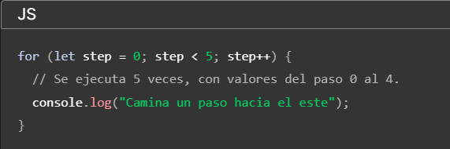

---

## Bucle “WHILE” 

El bucle while (mientras) tiene la siguiente sintaxis:

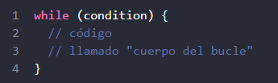

Mientras la condición condition sea verdadera, el código del cuerpo del bucle será ejecutado. Por ejemplo, el bucle debajo imprime i mientras se cumpla i < 3:

!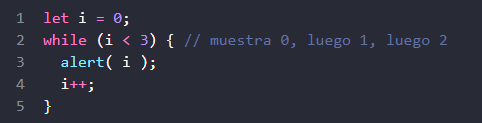

Cada ejecución del cuerpo del bucle se llama iteración. El bucle en el ejemplo de arriba realiza 3 iteraciones. Si faltara i++ en el ejemplo de arriba, el bucle sería repetido (en teoría) eternamente. En la práctica, el navegador tiene maneras de detener tales bucles desmedidos; y en el JavaScript del lado del servidor, podemos eliminar el proceso. Cualquier expresión o variable puede usarse como condición del bucle, no solo las comparaciones: El while evaluará y transformará la condición a un booleano. Por ejemplo, una manera más corta de escribir while (i != 0) es while (i): 3

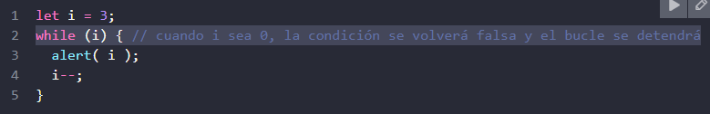

---

## Bucle “DO…WHILE” 
La comprobación de la condición puede ser movida debajo del cuerpo del bucle usando la sintaxis do..while:
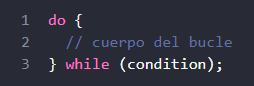

El bucle primero ejecuta el cuerpo, luego comprueba la condición, y, mientras sea un valor verdadero, la ejecuta una y otra vez. Por ejemplo:

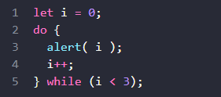
Esta sintaxis solo debe ser usada cuando quieres que el cuerpo del bucle sea ejecutado al menos una vez sin importar que la condición sea verdadera. Usualmente, se prefiere la otra forma: while(…) {…}. 4


---

## Bucle “FOR”
 El bucle for es más complejo, pero también el más usado. Se ve así:
 
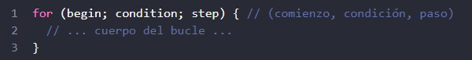

Aprendamos el significado de cada parte con un ejemplo. El bucle debajo corre alert(i) para i desde 0 hasta (pero no incluyendo) 3:


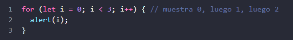


Vamos a examinar la declaración for parte por parte:
- comienzo let i = 0 Se ejecuta una vez al comienzo del bucle. 
- condición i < 3 Comprobada antes de cada iteración del bucle. Si es falsa, el bucle finaliza. 
- cuerpo alert(i) Se ejecuta una y otra vez mientras la condición sea verdadera. 
- paso i++ Se ejecuta después del cuerpo en cada iteración.


---


El algoritmo general del bucle funciona de esta forma:

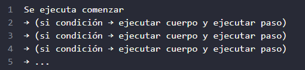

Si eres nuevo en bucles, te podría ayudar regresar al ejemplo y reproducir cómo se ejecuta paso por paso en un pedazo de papel. Esto es lo que sucede exactamente en nuestro caso:

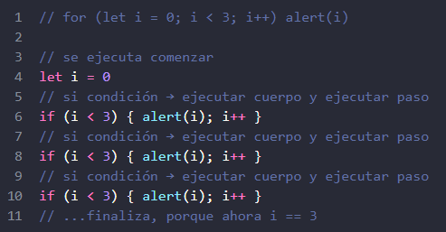

---

## Omitiendo Partes del FOR 
Cualquier parte de for puede ser omitida. Por ejemplo, podemos quitar comienzo si no necesitamos realizar nada al inicio del bucle. Como aquí:

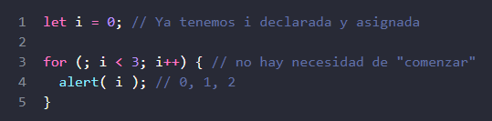

También podemos eliminar la parte paso:
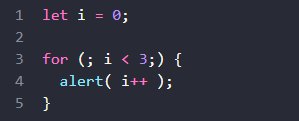

Esto hace al bucle idéntico a while (i < 3). En realidad podemos eliminar todo, creando un bucle infinito:

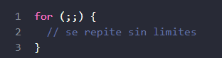

**NOTA: Por favor, nota que los dos punto y coma “;” del for deben estar presentes. De otra manera, habría un error de sintaxis.**

---

## Rompiendo el bucl

Normalmente, se sale de un bucle cuando la condición se vuelve falsa. Pero podemos forzar una salida en cualquier momento usando la directiva especial break. Por ejemplo, el bucle debajo le pide al usuario por una serie de números, “rompiéndolo” cuando un número no es ingresado:

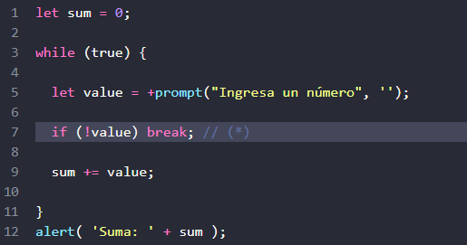
La directiva break es activada en la línea (*) si el usuario ingresa una línea vacía o cancela la entrada. Detiene inmediatamente el bucle, pasando el control a la primera línea después del bucle. En este caso, alert. La combinación “bucle infinito + break según sea necesario” es ideal en situaciones donde la condición del bucle debe ser comprobada no al inicio o al final del bucle, sino a la mitad o incluso en varias partes del cuerpo. 


---

## Continuar a la siguiente iteración
 La directiva continue es una “versión más ligera” de break. No detiene el bucle completo. En su lugar, detiene la iteración actual y fuerza al bucle a comenzar una nueva (si la condición lo permite). Podemos usarlo si hemos terminado con la iteración actual y nos gustaría movernos a la siguiente. El bucle debajo usa continue para mostrar solo valores impares:

 
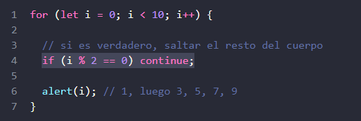

Para los valores pares de i, la directiva continue deja de ejecutar el cuerpo y pasa el control a la siguiente iteración de for (con el siguiente número). Así que el alert solo es llamado para valores impares. 


---

## Etiquetas para break/continue

 A veces necesitamos salirnos de múltiples bucles anidados al mismo tiempo. Por ejemplo, en el código debajo usamos un bucle sobre i y j, solicitando las coordenadas (i,j) de (0,0) a (3,3):

 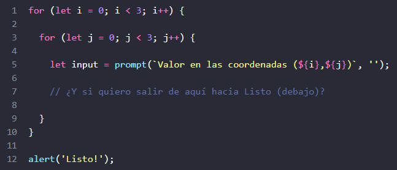

Necesitamos una manera de detener el proceso si el usuario cancela la entrada. El break ordinario después de input solo nos sacaría del bucle interno. Eso no es suficiente. ¡Etiquetas, vengan al rescate! 10


---

Una etiqueta es un identificador con un signo de dos puntos “:” antes de un bucle:
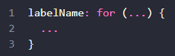

La declaración break <labelName> en el bucle debajo nos saca hacia la etiqueta:
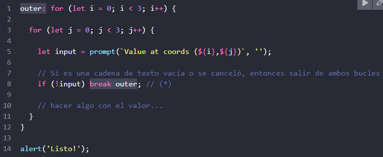


En el código de arriba, break outer mira hacia arriba por la etiqueta llamada outer y nos saca de dicho bucle. Así que el control va directamente de (*) a alert('Listo!').

---

 También podemos mover la etiqueta a una línea separada:

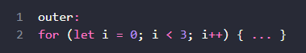

La directiva continue también puede usar usada con una etiqueta. En este caso, la ejecución del código salta a la siguiente iteración del bucle etiquetado. NOTA: Las etiquetas no nos permiten saltar a un lugar arbitrario en el código. Una directiva break debe estar en el interior del bucle. Aunque, técnicamente, puede estar en cualquier bloque de código etiquetado. 11


---

# RESUMEN 

 Cubrimos 3 tipos de bucles: 

- while – La condición es comprobada antes de cada iteración. 
-  do..while -  La condición es comprobada después de cada iteración. 
- for (;;) - La condición es comprobada antes de cada iteración, con ajustes adicionales disponibles.

Para crear un bucle “infinito”, usualmente se usa while(true). Un bucle como este, tal y como cualquier otro, puede ser detenido con la directiva break. Si queremos detener la iteración actual y adelantarnos a la siguiente, podemos usar la directiva continue. 

break/continue soportan etiquetas antes del bucle. Una etiqueta es la única forma de usar break/continue para escapar de un bucle anidado para ir a uno exterior. 

---

## TAREAS 

### Último valor del bucle 

 ¿Cuál es el último valor mostrado en alerta por este código? ¿Por qué? 
 
 ```
 let i = 3; while (i) { alert( i-- ); }
```
---

### Solución · último valor

Se muestran `3`, `2` y `1`. `i--` devuelve el valor actual antes de restarlo. Al quedar `i` en `0`, la condición del `while` es falsa y termina.

---

### ¿Qué valores serán mostrados por el bucle while? 
Para cada iteración del bucle, escribe qué valor será impreso y luego compáralo con la solución. Ambos bucles ¿alertan los mismos valores? 

#### La forma de prefijo ++i:
```
 let i = 0; 
 while (++i < 5) alert( i );
 ```
 
  #### La forma de sufijo
  ```
  let i = 0; 
   while (i++ < 5) alert( i );
   ```

---

### Solución · prefijo y sufijo en `while`

```text
++i: muestra 1, 2, 3, 4
i++: muestra 1, 2, 3, 4, 5
```

Con `++i`, incrementa antes de comparar. Con `i++`, compara el valor anterior y luego incrementa; el cuerpo muestra el valor incrementado.

---

### ¿Qué valores serán mostrados por el bucle while? 
Para cada iteración del bucle, escribe qué valor será impreso y luego compáralo con la solución. Ambos bucles ¿alertan los mismos valores? 

#### La forma de prefijo ++i: 
```
  let i = 0;
  while (++i < 5) alert( i ); 
  ```
 
#### La forma de sufijo   i++
 ```
  let i = 0; 
   while (i++ < 5) alert( i );
   ```

---

### Solución · repetición del ejercicio `while`

La salida es la misma que en el ejercicio anterior: `++i` muestra `1, 2, 3, 4`, mientras que `i++` muestra `1, 2, 3, 4, 5`.

---

### ¿Qué valores serán mostrados por el bucle "for"? 

Para cada bucle, anota qué valores mostrará y luego compara las respuestas. Ambos bucles, ¿muestran en alert los mismos valores? 

#### La forma del sufijo:

```for (let i = 0; 
 i < 5; i++) alert( i );
 ```
#### La forma del prefijo:

```for (let i = 0; i < 5; ++i) alert( i ); ```

---

### Solución · prefijo y sufijo en `for`

Ambos bucles muestran `0, 1, 2, 3, 4`. El valor producido por el incremento no se usa; tanto `i++` como `++i` dejan `i` incrementado para la siguiente comprobación.

---

### Muestra números pares en el bucle

 Usa el bucle for para mostrar números pares del 2 al 10. 
 
---

### Solución · números pares

```javascript
for (let i = 2; i <= 10; i += 2) {
  alert(i);
}
```

Muestra `2, 4, 6, 8, 10`.

---

### Reemplaza "for" por "while" 

Reescribe el código cambiando el bucle for a while sin alterar su comportamiento (la salida debería ser la misma). 

```javascript
let i = 0;
while (i < 3) {
    alert(`número ${i}!`);
    i++;
}
```

---

### Solución · reemplazar `while` por `for`

```javascript
for (let i = 0; i < 3; i++) {
  alert(`número ${i}!`);
}
```

Muestra `número 0!`, `número 1!` y `número 2!`, igual que el `while` dado.

---

### Repite hasta que la entrada sea correcta 

Escribe un bucle que solicite un número mayor que 100. Si el usuario ingresa otro número – pídele que ingrese un valor de nuevo. El bucle debe pedir un número hasta que el usuario ingrese un número mayor que 100 o bien cancele la entrada/ingrese una linea vacía. Aquí podemos asumir que el usuario solo ingresará números. No hay necesidad de implementar un manejo especial para entradas no numéricas en esta tarea. 

---

### Solución · repetir hasta recibir un número mayor que 100

```javascript
let entrada;
do {
  entrada = prompt("Escribe un número mayor que 100");
} while (entrada !== null && entrada !== "" && Number(entrada) <= 100);
```

El bucle termina si se introduce un número mayor que `100`, se cancela el `prompt` o se deja la entrada vacía.

---

### Muestra números primos 

Un número entero mayor que 1 es llamado primo si no puede ser dividido sin un resto por ningún número excepto 1 y él mismo.

 En otras palabras, n > 1 es un primo si no puede ser divido exactamente por ningún número excepto 1 y n. 
 
 Por ejemplo, 5 es un primo, porque no puede ser divido exactamente por 2, 3 y 4. 
 
 Escribe el código que muestre números primos en el intervalo de 2 a n.
 
  Para n = 10 el resultado será 2, 3, 5, 7. 
  
  PD. El código debería funcionar para cualquier n, no debe estar programado para valores fijos. 

---

### Solución · números primos hasta `n`

```javascript
const n = Number(prompt("Mostrar números primos hasta:"));
const primos = [];

for (let candidato = 2; candidato <= n; candidato++) {
  let esPrimo = true;
  for (let divisor = 2; divisor * divisor <= candidato; divisor++) {
    if (candidato % divisor === 0) {
      esPrimo = false;
      break;
    }
  }
  if (esPrimo) primos.push(candidato);
}

alert(primos.join(", "));
```

Para `n = 10`, muestra `2, 3, 5, 7`.

---

## Sentencia "switch"

 Una sentencia switch puede reemplazar múltiples condiciones if. Provee una mejor manera de comparar un valor con múltiples variantes. Switch tiene uno o más bloques casey un opcional default. Se ve de esta forma:

 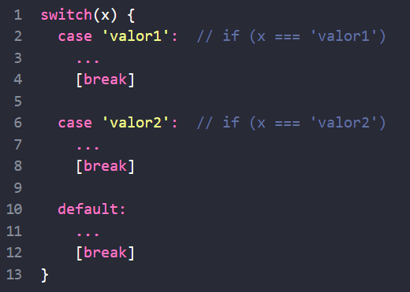

<BR>

• El valor de x es comparado contra el valor del primer case (en este caso, valor1), luego contra el segundo (valor2) y así sucesivamente, todo esto bajo una igualdad estricta. 

• Si la igualdad es encontrada, switch empieza a ejecutar el código iniciando por el primer case correspondiente, hasta el break más cercano (o hasta el final del switch). 

• Si no se cumple ningún caso entonces el código default es ejecutado (si existe). 17


---

### Un ejemplo de switch (se resalta el código ejecutado):


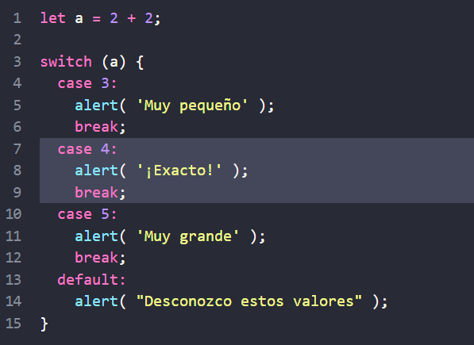

---

Aquí el switch inicia comparando a con la primera variante case que es 3. La comparación falla. 
Luego 4. 
La comparación es exitosa, por tanto la ejecución empieza desde case 4 hasta el break más cercano.

 Si no existe break entonces la ejecución continúa con el próximo case sin ninguna revisión. Un ejemplo sin break:


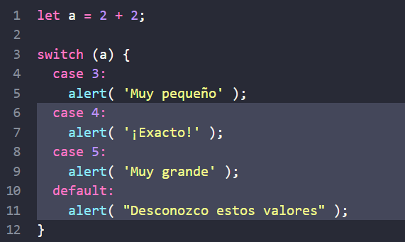

---

## Agrupamiento de “case” 
Varias variantes de case los cuales comparten el mismo código pueden ser agrupadas. Por ejemplo, si queremos que se ejecute el mismo código para case 3 y case 5:

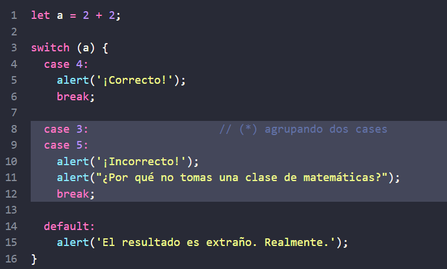

Ahora ambos, 3 y 5, muestran el mismo mensaje. La capacidad de “agrupar” los case es un efecto secundario de cómo trabaja switch/case sin break. Aquí la ejecución de case 3 inicia desde la línea (*) y continúa a través de case 5, porque no existe break. 


---

## El tipo importa
Vamos a enfatizar que la comparación de igualdad es siempre estricta. Los valores deben ser del mismo tipo para coincidir. Por ejemplo, consideremos el código:


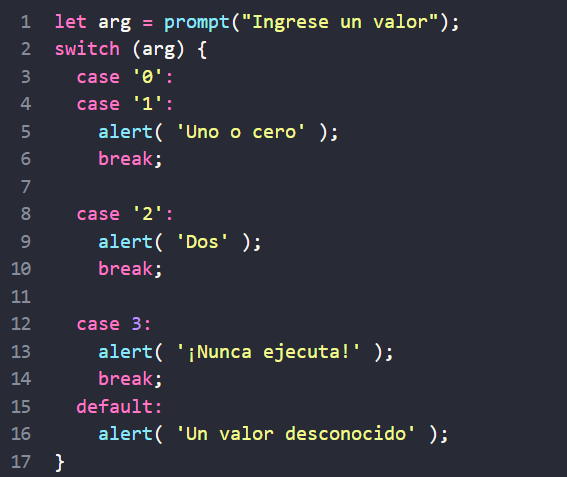


1. Para 0, 1, se ejecuta el primer alert. 
2. Para 2 se ejecuta el segundo alert. 
3. Pero para 3, el resultado del prompt es un string "3", el cual no es estrictamente igual === al número 3. Por tanto ¡Tenemos un código muerto en case 3! La variante default se ejecutará. 20


---

## TAREAS 

### Reescribe el "switch" en un "if" 

Escribe el código utilizando if..else que corresponda al siguiente switch: 

```
switch (navegador) { 
  case 'Edge': 
    alert( "¡Tienes Edge!" ); 
    break; 
  case 'Chrome': 
  case 'Firefox': 
  case 'Safari': 
  case 'Opera': 
    alert( 'Esta bien, soportamos estos navegadores también' ); 
    break; 
  default: 
    alert( '¡Esperamos que esta página se vea bien!' ); 
} 21
```

---

### Solución · `switch` a `if...else`

```javascript
if (navegador === "Edge") {
  alert("¡Tienes Edge!");
} else if (["Chrome", "Firefox", "Safari", "Opera"].includes(navegador)) {
  alert("Está bien, soportamos estos navegadores también");
} else {
  alert("¡Esperamos que esta página se vea bien!");
}
```

Se usa `===` para mantener la comparación estricta de `switch`.

---

## 


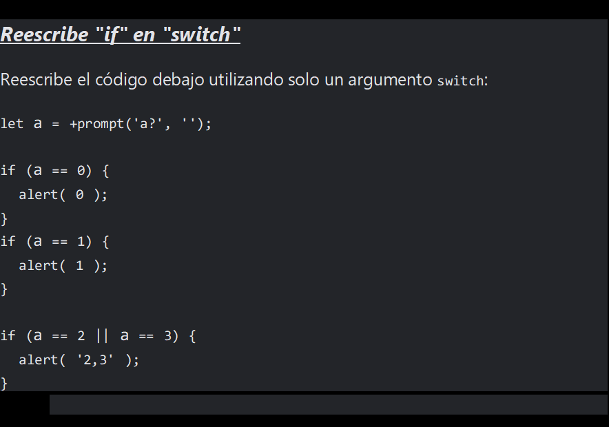

---

## ¿Qué son las funciones en javascript? 

- Las funciones son uno de los bloques de construcción fundamentales en JavaScript. Una función en JavaScript es similar a un procedimiento — un conjunto de instrucciones que realiza una tarea o calcula un valor, pero para que un procedimiento califique como función, debe tomar alguna entrada y devolver una salida donde hay alguna relación obvia entre la entrada y la salida. Para usar una función, debes definirla en algún lugar del ámbito desde el que deseas llamarla. 

- Una definición de función (también denominada declaración de función o expresión de función) consta de la palabra clave function, seguida de:  El nombre de la función.  Una lista de parámetros de la función, entre paréntesis y separados por comas.

- Las declaraciones de JavaScript que definen la función, encerradas entre llaves, { ... }.  Por ejemplo, el siguiente código define una función simple llamada square ("cuadrado"): 

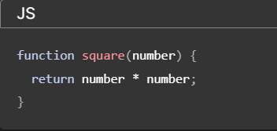

---

### Declaración de funciones 

Para crear una función podemos usar una declaración de función. Se ve como aquí:

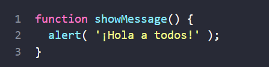

La palabra clave function va primero, luego va el nombre de función, luego una lista de parámetros entre paréntesis (separados por comas, vacía en el ejemplo anterior) y finalmente el código de la función entre llaves, también llamado “el cuerpo de la función”.


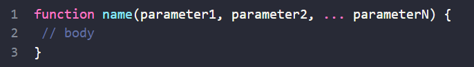

Nuestra nueva función puede ser llamada por su nombre: showMessage(). Por ejemplo:

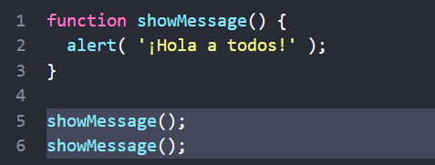

La llamada showMessage() ejecuta el código de la función. Aquí veremos el mensaje dos veces. Este ejemplo demuestra claramente uno de los propósitos principales de las funciones: evitar la duplicación de código… 

---

### Variables Locales

 Una variable declarada dentro de una función solo es visible dentro de esa función. Por ejemplo:

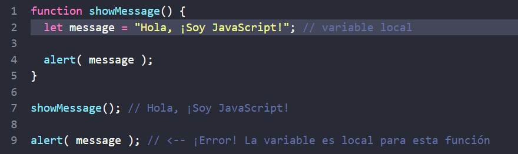


### Variables Externas

 Una función también puede acceder a una variable externa, por ejemplo:

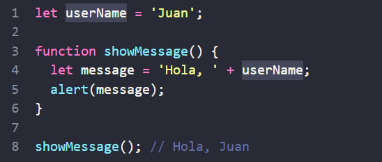

---


La función tiene acceso completo a la variable externa. Puede modificarlo también. Por ejemplo:


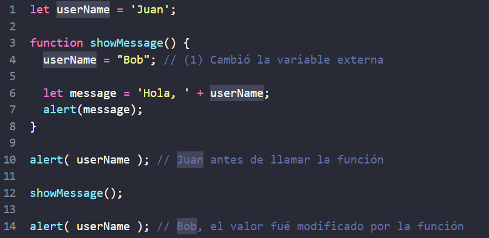

---

La variable externa solo se usa si no hay una local. Si una variable con el mismo nombre se declara dentro de la función, le hace sombra a la externa. Por ejemplo, en el siguiente código, la función usa la variable userName local. La exterior se ignora:


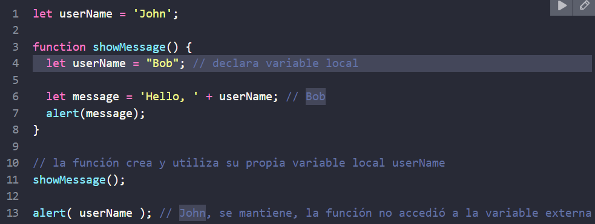

---

## Parámetros 

Podemos pasar datos arbitrarios a funciones usando parámetros. En el siguiente ejemplo, la función tiene dos parámetros: from y text.

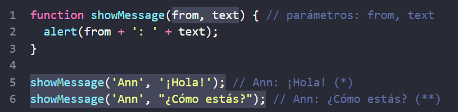

---

Cuando la función se llama (*) y (**), los valores dados se copian en variables locales from y text. Y la función las utiliza. Aquí hay un ejemplo más: tenemos una variable from y la pasamos a la función. Tenga en cuenta: la función cambia from, pero el cambio no se ve afuera, porque una función siempre obtiene una copia del valor:

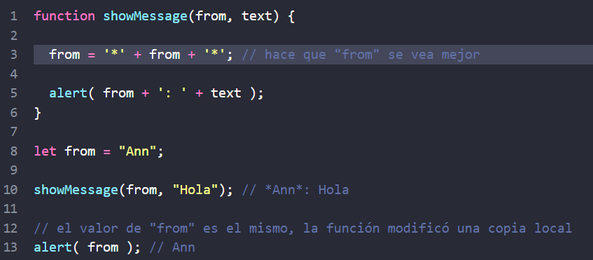

---

## 

- Cuando un valor es pasado como un parámetro de función, también se denomina argumento. Para poner los términos claros: 

  - Un parámetro es una variable listada dentro de los paréntesis en la declaración de función (es un término para el momento de la declaración) 

  - Un argumento es el valor que es pasado a la función cuando esta es llamada (es el término para el momento en que se llama) 

- Declaramos funciones listando sus parámetros, luego las llamamos pasándoles argumentos. En el ejemplo de arriba, se puede decir: "la función showMessage es declarada con dos parámetros, y luego llamada con dos argumentos: from y "Hola"".

---

### Valores predeterminados

 Si una función es llamada, pero no se le proporciona un argumento, su valor correspondiente se convierte en undefined. Por ejemplo, la función mencionada anteriormente showMessage(from, text) se puede llamar con un solo argumento:

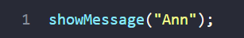

Eso no es un error. La llamada mostraría "Ann: undefined". Como no se pasa un valor de text, este se vuelve undefined. Podemos especificar un valor llamado “predeterminado” o “por defecto” (es el valor que se usa si el argumento fue omitido) en la declaración de función usando =:

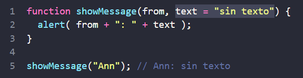

Ahora, si no se pasa el parámetro text, obtendrá el valor "sin texto". El valor predeterminado también se asigna si el parámetro existe pero es estrictamente igual a undefined:

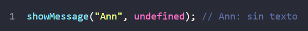

---


Aquí "sin texto" es un string, pero puede ser una expresión más compleja, la cual solo es evaluada y asignada si el parámetro falta. Entonces, esto también es posible:


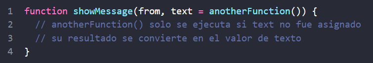

NOTA: Años atrás, JavaScript no soportaba la sintaxis para parámetros predeterminados. Entonces se usaban otras formas para especificarlos. 


---

### Parámetros predeterminados alternativos

 A veces tiene sentido asignar valores predeterminados a los parámetros más tarde, después de la declaración de función. Podemos verificar si un parámetro es pasado durante la ejecución de la función comparándolo con undefined:

 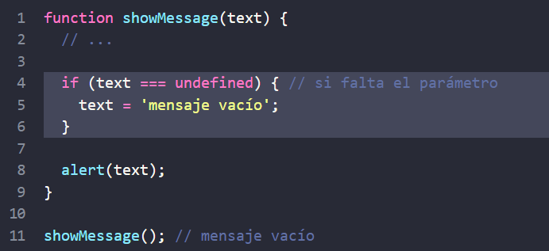

 ---


…O podemos usar el operador “||”:

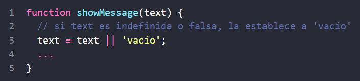

Los intérpretes de JavaScript modernos soportan el operador nullish coalescing ??, que es mejor cuando el valor de 0 debe ser considerado “normal” en lugar de falso:


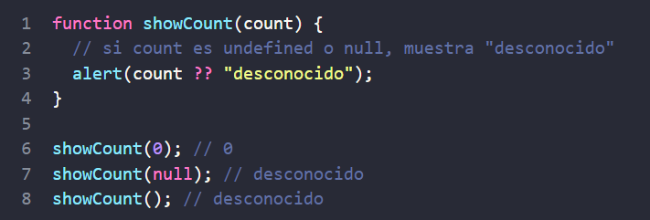

---

### Devolviendo un valor

Una función puede devolver un valor al código de llamada como resultado. El ejemplo más simple sería una función que suma dos valores:


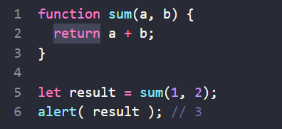

---


La directiva return puede estar en cualquier lugar de la función. Cuando la ejecución lo alcanza, la función se detiene y el valor se devuelve al código de llamada (asignado al result anterior). Puede haber muchos return en una sola función. Por ejemplo:


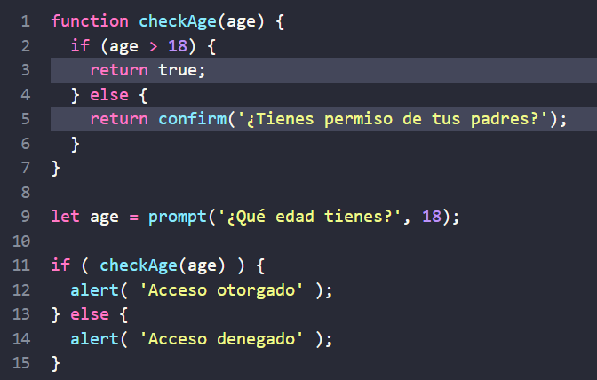

---

## 

Es posible utilizar return sin ningún valor. Eso hace que la función salga o termine inmediatamente. Por ejemplo:

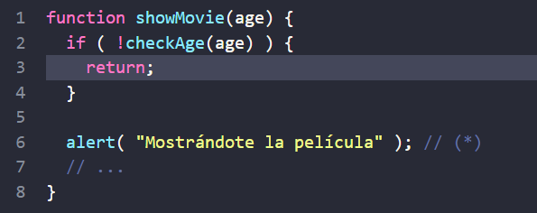

En el código de arriba, si checkAge(age) devuelve false, entonces showMovie no mostrará la alert. 32


---

## Nomenclatura de funciones

Entonces su nombre suele ser un verbo. Debe ser breve, lo más preciso posible y describir lo que hace la función, para que alguien que lea el código obtenga una indicación de lo que hace la función.

Es una práctica generalizada comenzar una función con un prefijo verbal que describe vagamente la acción. Debe haber un acuerdo dentro del equipo sobre el significado de los prefijos. Por ejemplo, funciones que comienzan con "show" usualmente muestran algo. Funciones que comienza con…

 • "get…" – devuelven un valor, 
 • "calc…" – calculan algo, 
 • "create…" – crean algo, 
 • "check…" – revisan algo y devuelven un boolean, etc. Ejemplos de este tipo de nombres:

Con los prefijos en su lugar, un vistazo al nombre de una función permite comprender qué tipo de trabajo realiza y qué tipo de valor devuelve. 33


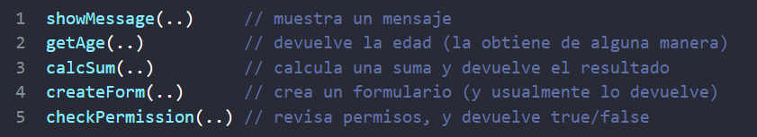

---

## Funciones == Comentarios 

Las funciones deben ser cortas y hacer exactamente una cosa. Si esa cosa es grande, tal vez valga la pena dividir la función en algunas funciones más pequeñas. A veces, seguir esta regla puede no ser tan fácil, pero definitivamente es algo bueno. 

Una función separada no solo es más fácil de probar y depurar, – ¡su existencia es un gran comentario! Por ejemplo, comparemos las dos funciones showPrimes(n) siguientes. Cada una devuelve números primos hasta n. La primera variante usa una etiqueta:


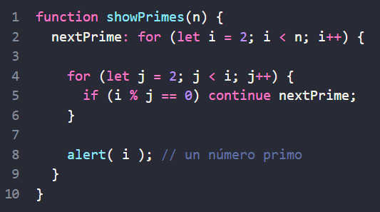

---

La segunda variante usa una función adicional isPrime(n) para probar la primalidad:

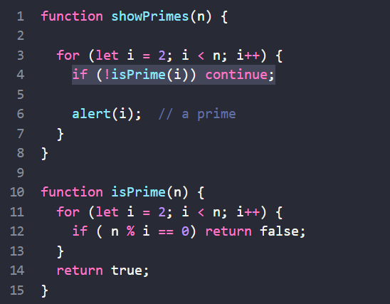

La segunda variante es más fácil de entender, ¿no? En lugar del código, vemos un nombre de la acción. (isPrime). A veces las personas se refieren a dicho código como autodescriptivo. Por lo tanto, las funciones se pueden crear incluso si no tenemos la intención de reutilizarlas. Estructuran el código y lo hacen legible. 35


---

# RESUMEN

- Una declaración de función se ve así:

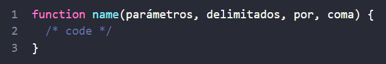

    - Los valores pasados a una función como parámetros se copian a sus variables locales. 
    - Una función puede acceder a variables externas. Pero funciona solo de adentro hacia afuera. El código fuera de la función no ve sus variables locales. 
    - Una función puede devolver un valor. Si no lo hace, entonces su resultado es undefined.
 
 - Para que el código sea limpio y fácil de entender, se recomienda utilizar principalmente variables y parámetros locales en la función, no variables externas. 
 - Siempre es más fácil entender una función que obtiene parámetros, trabaja con ellos y devuelve un resultado que una función que no obtiene parámetros, pero modifica las variables externas como un efecto secundario. Nomenclatura de funciones: 
 
    - Un nombre debe describir claramente lo que hace la función. Cuando vemos una llamada a la función en el código, un buen nombre nos da al instante una comprensión de lo que hace y devuelve.
    - Una función es una acción, por lo que los nombres de las funciones suelen ser verbales.
    - Existen muchos prefijos de funciones bien conocidos como create…, show…, get…, check… y así. Úsalos para insinuar lo que hace una función. 
    
- Las funciones son los principales bloques de construcción de los scripts. Ahora hemos cubierto los conceptos básicos, por lo que en realidad podemos comenzar a crearlos y usarlos. Pero ese es solo el comienzo del camino. Volveremos a ellos muchas veces, profundizando en sus funciones avanzadas. 


---

## TAREAS

 ### ¿Es "else" requerido?
  La siguiente función devuelve true si el parámetro age es mayor a 18. De lo contrario, solicita una confirmación y devuelve su resultado:
  
  ```javascript
 function checkAge(age)  {
   if (age > 18) {
     return true; 
     } else { // ... 
     // 
     return confirm('¿Tus padres te permitieron?');
      }
       }
   ```


¿Funcionará la función de manera diferente si se borra else? 


```javascript
function checkAge(age) {
   if (age > 18) {
     return true;
      } // ... 
      // 
      return confirm('¿Tus padres te permitieron?'); }
 
```


  ¿Hay alguna diferencia en el comportamiento de estas dos variantes? 37

---

### Solución · ¿es necesario `else`?

No. Ambas versiones se comportan igual: cuando `age > 18`, `return true` termina la función. Si no, se ejecuta la confirmación.

```javascript
function checkAge(age) {
  if (age > 18) return true;
  return confirm("¿Tus padres te permitieron?");
}
```

---

### Reescribe la función utilizando '?' o '||'

 La siguiente función devuelve true si el parámetro age es mayor que 18.

  De lo contrario, solicita una confirmación y devuelve su resultado. 
  
  ```javascript
  function checkAge(age) {
     if (age > 18) {
       return true; 
    } else { 
      return confirm('¿Tienes permiso de tus padres?'); 
    }
  }
  ```
  Reescríbela para realizar lo mismo, pero sin if, en una sola linea. 

  Haz dos variantes de checkAge: 
  - Usando un operador de signo de interrogación ? 
  - Usando OR || 

---

### Solución · `checkAge` con `?` y `||`

```javascript
function checkAgeTernario(age) {
  return age > 18 ? true : confirm("¿Tienes permiso de tus padres?");
}

function checkAgeOr(age) {
  return age > 18 || confirm("¿Tienes permiso de tus padres?");
}
```

Ambas funciones devuelven `true` cuando `age > 18`; en caso contrario, devuelven el resultado de `confirm`.

---
  
  ### Función min(a, b) 
  
  Escriba una función min(a,b) la cual devuelva el menor de dos números a y b. 
  Por ejemplo: min(2, 5) == 2 min(3, -1) == -1

min(1, 1) == 1 38

---

### Solución · `min(a, b)`

```javascript
function min(a, b) {
  return a < b ? a : b;
}
```

Si ambos valores son iguales, devuelve cualquiera de ellos; el resultado sigue siendo el mínimo.

---

### Función pow(x,n) 

Escriba la función pow(x,n) que devuelva x como potencia de n. O, en otras palabras, multiplique x por si mismo n veces y devuelva el resultado.

```  
pow(3, 2) = 3 * 3 = 9 
pow(3, 3) = 3 * 3 * 3 = 27 
pow(1, 100) = 1 * 1 * ...* 1 = 1

```
 Cree una página web que solicite x y n, y luego muestre el resultado de pow(x,n).
 
 En esta tarea, la función solo debe admitir valores naturales de n: enteros desde 1. 

---

### Solución · `pow(x, n)`

```javascript
function pow(x, n) {
  if (!Number.isInteger(n) || n < 1) {
    return "n debe ser un entero natural mayor o igual que 1";
  }

  let resultado = 1;
  for (let i = 0; i < n; i++) {
    resultado *= x;
  }
  return resultado;
}

const x = Number(prompt("Introduce x:"));
const n = Number(prompt("Introduce n (entero desde 1):"));
alert(pow(x, n));
```

---

## Expresiones de función

 En JavaScript, una función no es una “estructura mágica del lenguaje”, sino un tipo de valor especial. La sintaxis que usamos antes se llama Declaración de Función:

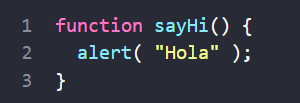

Existe otra sintaxis para crear una función que se llama una Expresión de Función. Esto nos permite crear una nueva función en el medio de cualquier expresión. Por ejemplo:


Aquí podemos ver una variable sayHi obteniendo un valor —la nueva función— creada como function() { alert("Hello"); }. 

Como la creación de una función ocurre en el contexto de una expresión de asignación, (el lado derecho de =), esto es una Expresión de función. Note que no hay un nombre después de la palabra clave function. Omitir el nombre está permitido en las expresiones de función. 

Aquí la asignamos directamente a la variable, así que el significado de estos ejemplos de código es el mismo: "crear una función y ponerla en la variable sayHi".


---

## La función es un valor 

Una función es un valor. Ambos ejemplos arriba almacenan una función en la variable sayHi. Incluso podemos mostrar aquel valor usando alert:


Tener en cuenta que la última línea no ejecuta la función, porque no hay paréntesis después de sayHi. Existen lenguajes de programación en los que cualquier mención del nombre de una función causa su ejecución, pero JavaScript no funciona así. 

En JavaScript, una función es un valor, por lo tanto podemos tratarlo como un valor. El código de arriba muestra su representación de cadena, que es el código fuente. Por supuesto que es un valor especial, en el sentido que podemos invocarlo de esta forma sayHi(). Pero sigue siendo un valor. Entonces podemos trabajar con ello como trabajamos con otro tipo de valores. 


---

Podemos copiar una función a otra variable:


Esto es lo que sucede arriba en detalle: 
  1. La Declaración de la Función (1) crea la función y la coloca dentro de la variable llamada sayHi. 
  2. Línea(2) copia la función en la variable func. 
  3. Ahora la función puede ser llamada de ambas maneras, sayHi() y func(). 
  
También podríamos haber usado una expresión de función para declarar sayHi en la primera línea:


---

*** NOTA: La respuesta es simple: una expresión de función se crea aquí como function(…) {…} dentro de la sentencia de asignación let sayHi = …;. El punto y coma se recomienda para finalizar la sentencia, no es parte de la sintaxis de función. ***


---

## Funciones Callback

 Veamos más ejemplos del pasaje de funciones como valores y el uso de expresiones de función. Escribimos una función ask(question, yes, no) con tres argumentos: 

  ➔ question 
 Texto de la pregunta  
 ---->   yes 
 Función a ejecutar si la respuesta es “Yes” 
 ----> no 
 Función a ejecutar si la respuesta es “No”


  La función deberá preguntar la question y, dependiendo de la respuesta del usuario, llamar yes() o no():

 


---

En la práctica, tales funciones son bastante útiles. La mayor diferencia entre la función ask en la vida real y el ejemplo anterior es que las funciones de la vida real utilizan formas para interactuar con el usuario más complejas que un simple confirme. Los argumentos de ask se llaman funciones callback o simplemente callbacks. La idea es que pasamos una función y esperamos que se “devuelva la llamada” más tarde si es necesario. 

En nuestro caso, showOk se convierte en la callback para la respuesta “Yes”, y showCancel para la respuesta “No”. Podemos usar Expresión de Función para redactar una función equivalente y más corta:


Aquí, las funciones son declaradas justo dentro del llamado ask(...). No tienen nombre, y por lo tanto se denominan anónimas. Tales funciones no se pueden acceder fuera de ask (porque no están asignadas a variables), pero eso es justo lo que queremos aquí. 


---

## Expresión de Función vs Declaración de Función

 Formulemos las principales diferencias entre Declaración y Expresión de Funciones. Primero, la sintaxis: cómo diferenciarlas en el código. 
 
 ➔ Declaración de Función: una función, declarada como una instrucción separada, en el flujo de código principal.


➔ Expresión de Función: una función, creada dentro de una expresión o dentro de otra construcción sintáctica. Aquí, la función es creada en el lado derecho de la “expresión de asignación” =:


---


Una Expresión de Función es creada cuando la ejecución la alcance y es utilizable desde ahí en adelante. Una vez que el flujo de ejecución pase al lado derecho de la asignación let sum = function… – aquí vamos, la función es creada y puede ser usada (asignada, llamada, etc.) de ahora en adelante.

Las Declaraciones de Función son diferente. Una Declaración de Función puede ser llamada antes de ser definida.

 Por ejemplo, una Declaración de Función global es visible en todo el script, sin importar dónde se esté. Esto se debe a los algoritmos internos. Cuando JavaScript se prepara para ejecutar el script, primero busca Declaraciones de Funciones globales en él y crea las funciones. Podemos pensar en esto como una “etapa de inicialización”.

Y después de que se procesen todas las Declaraciones de Funciones, el código se ejecuta. Entonces tiene acceso a estas funciones. Por ejemplo, esto funciona:


---

La Declaración de Función sayHi es creada cuando JavaScript está preparándose para iniciar el script y es visible en todas partes. 

…Si fuera una Expresión de Función, entonces no funcionaría:


Las Expresiones de Función son creadas cuando la ejecución las alcance. Esto podría pasar solamente en la línea (*). Demasiado tarde. 

Otra característica especial de las Declaraciones de Funciones es su alcance de bloque. 

En modo estricto, cuando una Declaración de Función se encuentra dentro de un bloque de código, es visible en todas partes dentro de ese bloque. Pero no fuera de él. 


---


Por ejemplo, imaginemos que necesitamos declarar una función welcome() dependiendo de la variable age que obtengamos durante el tiempo de ejecución. Y luego planeamos usarlo algún tiempo después. Si utilizamos la Declaración de Funciones, no funcionará como se esperaba:


---

Esto se debe a que una Declaración de Función sólo es visible dentro del bloque de código en el que reside. Aquí hay otro ejemplo:


---


¿Qué podemos hacer para que welcome sea visible fuera de ‘if’? El enfoque correcto sería utilizar una Expresión de Función y asignar welcome a la variable que se declara fuera de ‘if’ y tiene la visibilidad adecuada. Este código funciona según lo previsto:


---

O lo podemos simplificar aún más usando un operador de signo de pregunta ?:


---

# RESUMEN

    - Las funciones son valores. Se pueden asignar, copiar o declarar en cualquier lugar del código.
    - Si la función se declara como una declaración separada en el flujo del código principal, eso se llama “Declaración de función”.  
    - Si la función se crea como parte de una expresión, se llama “Expresión de función”.
    - Las Declaraciones de Funciones se procesan antes de ejecutar el bloque de código. Son visibles en todas partes del bloque.
    - Las Expresiones de Función se crean cuando el flujo de ejecución las alcanza. 
- En la mayoría de los casos, cuando necesitamos declarar una función, es preferible una Declaración de Función, ya que es visible antes de la declaración misma. Eso nos da más flexibilidad en la organización del código, y generalmente es más legible.
- Por lo tanto, deberíamos usar una Expresión de Función solo cuando una Declaración de Función no sea adecuada para la tarea. Hemos visto un par de ejemplos de eso en este capítulo, y veremos más en el futuro. 50

--- 

### Funciones Flecha, lo básico
 Hay otra sintaxis muy simple y concisa para crear funciones, que a menudo es mejor que las Expresiones de funciones. Se llama “funciones de flecha”, porque se ve así:


Esto crea una función func que acepta los parámetros arg1..argN, luego evalúa la expression del lado derecho mediante su uso y devuelve su resultado. En otras palabras, es la versión más corta de:


Veamos un ejemplo concreto:


---


Como puedes ver, (a, b) => a + b significa una función que acepta dos argumentos llamados a y b. Tras la ejecución, evalúa la expresión a + b y devuelve el resultado.

 • Si solo tenemos un argumento, se pueden omitir paréntesis alrededor de los parámetros, lo que lo hace aún más corto. Por ejemplo:
 

• Si no hay parámetros, los paréntesis estarán vacíos; pero deben estar presentes:


---

## 

Las funciones de flecha se pueden usar de la misma manera que las expresiones de función. Por ejemplo, para crear dinámicamente una función:


Las funciones de flecha pueden parecer desconocidas y poco legibles al principio, pero eso cambia rápidamente a medida que los ojos se acostumbran a la estructura. Son muy convenientes para acciones simples de una línea, cuando somos demasiado flojos para escribir muchas palabras. 

---

## Funciones de flecha multilínea
 Las funciones de flecha que estuvimos viendo eran muy simples. Toman los parámetros a la izquierda de =>, los evalúan y devuelven la expresión del lado derecho. A veces necesitamos una función más compleja, con múltiples expresiones o sentencias. En ese caso debemos encerrarlos entre llaves. La diferencia principal es que las llaves necesitan usar un return para devolver un valor (tal como lo hacen las funciones comunes). Como esto:


---

# RESUMEN

- Las funciones de flecha son útiles para acciones simples, especialmente las de una sola línea. Vienen en dos variantes:
  - Sin llaves: (...args) => expression – el lado derecho es una expresión: la función la evalúa y devuelve el resultado. Pueden omitirse los paréntesis si solo hay un argumento, por ejemplo n => n*2. 
  - Con llaves: (...args) => { body } – las llaves nos permiten escribir varias declaraciones dentro de la función, pero necesitamos un return explícito para devolver algo. 

---

## TAREAS

 ### Reescribe con funciones de flecha
 
 Reemplaza las expresiones de función con funciones de flecha en el código a continuación:
 
 ```javascript
 function ask(question, yes, no) {
  if (confirm(question)) yes();
  else no();
}

ask( "Do you agree?", 

function() {
  alert("You agreed.");
},

function() {
  alert("You canceled the execution.");
} 
 );
```

---

### Solución · callbacks con funciones flecha

```javascript
function ask(question, yes, no) {
  if (confirm(question)) yes();
  else no();
}

ask(
  "Do you agree?",
  () => alert("You agreed."),
  () => alert("You canceled the execution.")
);
```

La función `ask` no cambia; las dos funciones callback anónimas se sustituyen por funciones flecha.

