 _Desarrollo Web en Entorno Cliente_ 

Introducción: callbacks

loadScript\(src\)\,

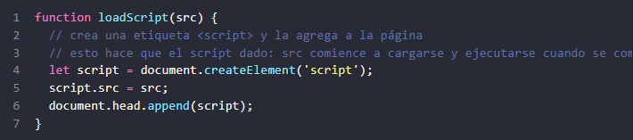

Esto inserta en el documento una etiqueta nueva\, creada dinámicamente\, \<script src =" \.\.\. "> 

con el código src dado\. El navegador comienza a cargarlo automáticamente y lo ejecuta cuando 

la carga se completa\. Podemos usar esta función así: 

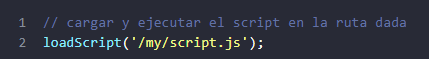

El script se ejecuta “asincrónicamente”\, ya que 

comienza a cargarse ahora\, pero se ejecuta más 

tarde\, cuando la función ya ha finalizado\. El código debajo de loadScript \(\.\.\.\)\, no espera que 

finalice la carga del script\. 

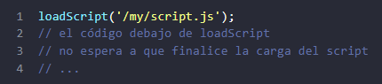

Digamos que necesitamos usar el nuevo script tan pronto como se cargue\. Este script declara 

nuevas funciones\, y las queremos ejecutar\. Si lo hacemos inmediatamente después de llamar a 

loadScript \(\.\.\.\)\, no funcionarán: 

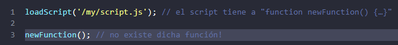

Es natural\, porque el navegador no tuvo tiempo de cargar el script\. Hasta el momento\, la 

función loadScript no proporciona una forma de monitorear la finalización de la carga\. El script 

se carga y finalmente se ejecuta\, eso es todo\. Pero necesitamos saber cuándo sucede\, para 

poder usar las funciones y variables nuevas de dicho script\. 

Agreguemos a loadScript un segundo argumento: una función callback que se ejecuta cuando 

se completa la carga el script: 

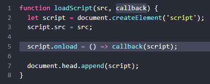

básicamente ejecuta una función después de que el script fue cargado y ejecutado\. 

Ahora\, si queremos llamar las nuevas funciones desde el script\, lo hacemos dentro de la callback: 

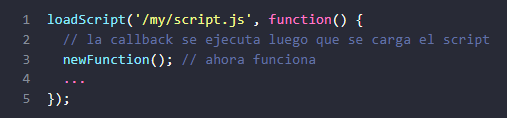

Esa es la idea: el segundo argumento es una función \(generalmente anónima\) que se ejecuta 

cuando se completa la acción\. Aquí un ejemplo ejecutable con un script real: 

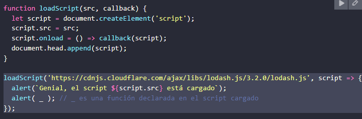

Eso se llama programación asincrónica “basado en callback”\. Una función que hace algo de 

forma asincrónica debería aceptar un argumento de callback donde ponemos la función por 

ejecutar después de que se complete\. Aquí lo hicimos en loadScript\, pero por supuesto es un 

enfoque general\. 

 _Callback en una callback _ 

¿Cómo podemos cargar dos scripts secuencialmente\, el segundo en cuanto haya terminado de 

cargarse el primero? La solución natural sería poner la segunda llamada loadScript dentro de la 

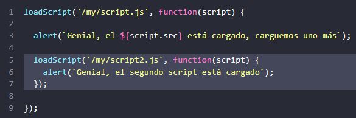

queremos un script más …?

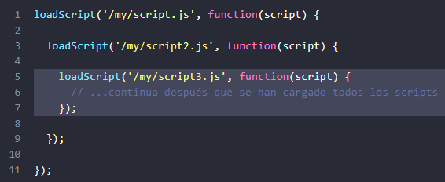

acciones\, pero no en todos los casos; así que pronto veremos otras variantes\. 

 _Manejo de errores _ 

En los ejemplos anteriores no consideramos los errores\. ¿Qué pasa si falla la carga del script? 

Nuestra callback debería poder reaccionar ante eso\. Aquí una versión mejorada de loadScript 

que monitorea los errores de carga: 

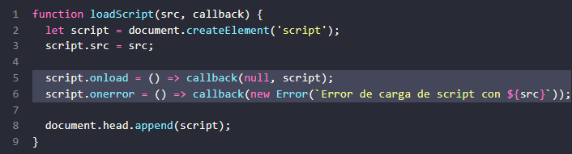

Para una carga exitosa llama a callback\(null\, script\) y de lo contrario a callback\(error\)\. El uso: 

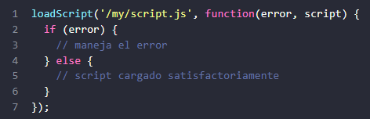

conoce como “error first callback” \(callback con el error primero\)\.

 La convención es: 

El primer argumento de la ‘callback’ está reservado para un error\, si este ocurre\. En tal 

caso se llama a callback\(err\)\. 

El segundo argumento \(y los siguientes si es necesario\) son para el resultado exitoso\. En 

este caso se llama a callback\(null\, result1\, result2 \.\.\.\)\. 

informar errores 

 _Pirámide infernal _ 

A primera vista\, es una forma viable de codificación asincrónica\. Y de hecho lo es\. Para una o 

quizás dos llamadas anidadas\, se ve bien\. Pero para múltiples acciones asincrónicas que van una 

tras otra\, tendremos un código como este: 

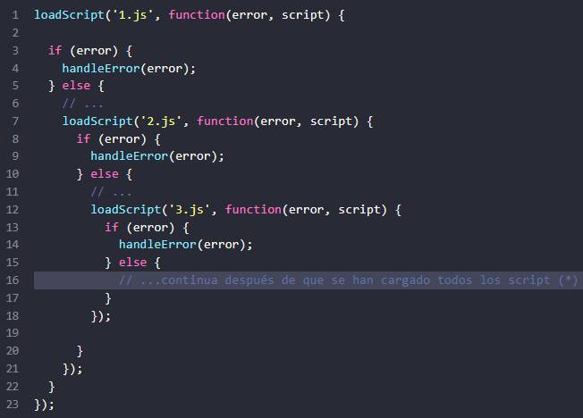

En el código de arriba: 

Cargamos 1\.js\, entonces si no hay error…

Cargamos 2\.js\, entonc

es si no hay error…

Cargamos 3\.js\, entonces\, si no hay ningún error: haga otra cosa \(\*\)\. 

administrar\, especialmente si tenemos un código real en lugar de ‘…’ que puede i

bucles\, declaraciones condicionales\, etc\. A esto se le llama “infierno de callbacks” o “pirámide 

infernal” \(“callback hell”\, “pyramid of doom”\)\.

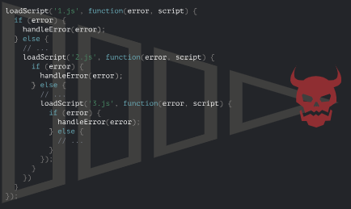

La “pirámide” de llamadas anidadas crece hacia la derecha con cada acción asincrónica\. Pronto 

se sale de control\. 

Entonces esta forma de codificación no es tan buena\. Podemos tratar de aliviar el problema 

haciendo\, para cada acción\, una función independiente: 

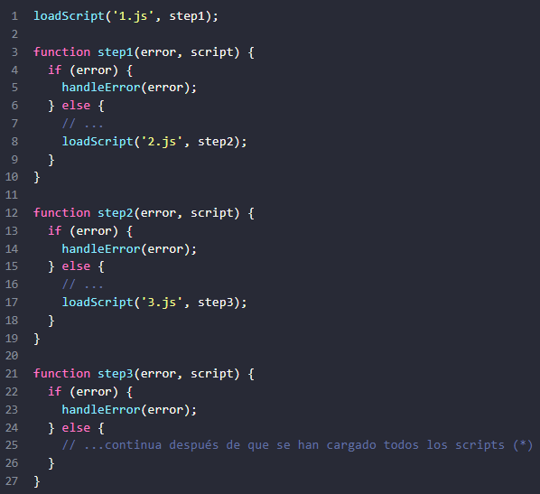

¿Lo Ves? Hace lo mismo\, y ahora no hay anidamiento profundo porque convertimos cada acción 

en una función de nivel superior separada\. 

notado que hay que saltar de un lado a otro mientras lees\. Es un inconveniente\, especialmente 

si el lector no está familiarizado con el código y no sabe dónde dirigir la mirada\. Además\, las 

funciones llamadas step\* son de un solo uso\, existen únicamente para evitar la “Pirámide de 

abarrotados aquí\. 

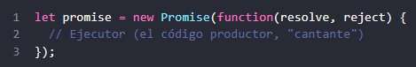

Más adelante veremos cómo los “fanáticos” pueden suscribirse a estos cambios\.

Aquí hay un ejemplo de un constructor de promesas y una función ejecutora simple con “código 

productor” que toma tiempo \(a través 

de setTimeout\): 

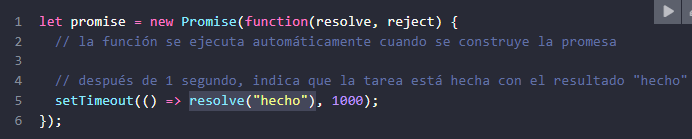

Podemos ver dos cosas al ejecutar el código anterior: 

Se llama al ejecutor de forma automática e inmediata \(por new Promise\)\. 

El ejecutor recibe dos argumentos: resolve y reject\. Estas funciones están predefinidas 

por el motor de JavaScript\, por lo que no necesitamos crearlas\. Solo debemos llamar a 

una de ellas cuando esté listo\. 

Después de un segundo de “procesamiento”\, el ejecutor llama a resolve\("hecho"\) para 

producir el resultado\. Esto cambia el estado del objeto promise: 

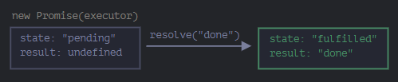

ejemplo de finalización exitosa de la tarea\, una “promesa cumplida”\. Y ahora un 

ejemplo del ejecutor rechazando la promesa con un error: 

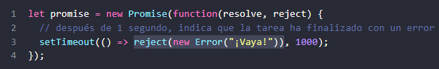

La llamada a reject\(\.\.\.\) mueve el objeto promise al estado "rechazado": 

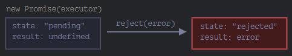

Para resumir\, el ejecutor debe realizar una tarea \(generalmente algo que toma tiempo\) y luego 

llamar a “resolve” o a “reject” para cambiar el estado del objeto promise correspondiente\.

consideramos “establecida”\.

 _Consumidores: then y catch _ 

Un objeto Promise sirve como enlace entre el ejecutor \(el “código productor” o el “cantante”\) y 

funciones de consumo pueden registrarse \(suscribirse\) utilizando los métodos 

El más importante y fundamental es “\.then”\. La sintaxis es:

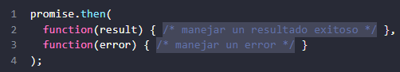

El primer argumento de “\.then” es una función que se ejecuta cuando se resuelve la promesa y 

recibe el resultado\. 

El segundo argumento d

e “\.then” es una función que se ejecuta cuando se rechaza la promesa 

y recibe el error\. 

Por ejemplo\, aquí hay una reacción a una promesa resuelta con éxito: 

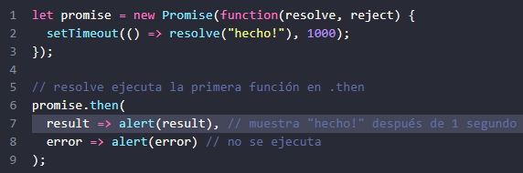

La primera función fue ejecutada\. Y en el caso de un rechazo\, el segundo: 

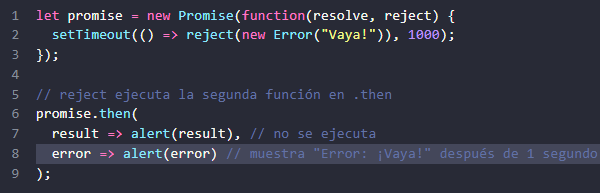

argumento de función para 

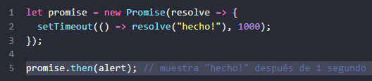

\.then\(null\, errorHandlingFunction\)

\. O podemos usar 

\.catch\(errorHandlingFunction\)

exactamente lo mismo: 

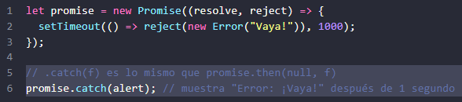

 __LIMPIEZA: FINALLY __ 

promesas\. La llamada 

 en el sentido de que f siempre se 

ejecuta cuando se resuelve la promesa: ya sea que se resuelva o rechace\. 

La idea de finally es establecer un manejador para realizar la limpieza y finalización después de 

que las operaciones se hubieran completado\. Por ejemplo\, detener indicadores de carga\, cerrar 

conexiones que ya no son necesarias\, etc\. 

Puedes pensarlo como el finalizador de la fiesta\. No importa si la fiesta fue buena o mala ni 

cuántos invitados hubo\, aún necesitamos \(o al menos deberíamos\) hacer la limpieza después\. El 

código puede verse como esto: 

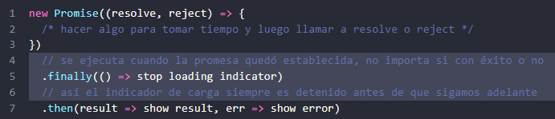

Sin embargo\, note que finally\(f\) no es exactamente un alias dethen\(f\, f\)\`\. 

Hay diferencias importantes:  

exitosa o no\. Eso está bien\, ya que usualmente nuestra tarea es realizar procedimientos 

de finalización “generales”\.

argumentos\, y lo que sale de la promesa es manejado en el siguiente manejador\. 

Resultados y errores pasan “a través” del manejador de finally\. Estos pasan al siguiente 

manejador que se adecúe\. Por ejemplo\, aquí el resultado se pasa a través de finally al 

then que le sigue: 

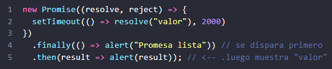

Como puedes ver\, el “valor” devuelto por la primera promesa es pasado a través de 

finally al siguiente then\. 

Esto es muy conveniente\, porque finally no está destinado a procesar el resultado de 

una promesa\. Como dijimos antes\, es el lugar para hacer la limpieza general sin importar 

cuál haya sido el resultado\. Y aquí\, el ejemplo de un error\. Vemos cómo se pasa a través 

de finally a catch: 

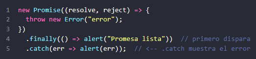

ignorado silenciosamente\. 

La única excepción a esta regla se da cuando el manejador mismo de finally dispara un 

error\. En ese caso\, este error pasa al siguiente manejador de error en lugar del resultado 

previo al finally\. Para summarizar: 

Un manejador finally no obtiene lo que resultó del manejador previo \(no tiene 

argumentos\)\. Ese resultado es pasado a través de él al siguiente manejador\. 

Si el manejador de finally devuelve algo\, será ignorado\. 

Cuando es finally el que dispara el error\, la ejecución pasa al manejador de error 

Estas características son de ayuda y hacen que las cosas funcionen tal como corresponde si 

“finalizamos” con finally como se supone: con procedimientos d

e limpieza genéricos\. 

 _Ejemplo: loadScript _ 

continuación\, veamos 

escribir código asincrónico\. Tomemos\, del capítulo anterior\, la función loadScript para cargar un 

script\. Esta es la variante basada callback\, solo para recordarnos: 

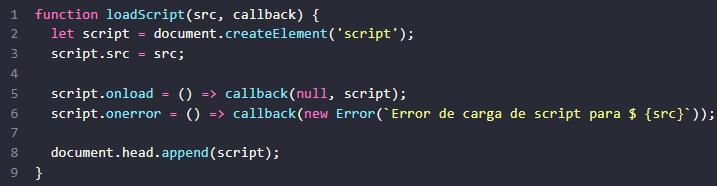

Reescribámoslo usando Promesas\. 

La nueva función loadScript no requerirá una callback\. En su lugar\, creará y devolverá un objeto 

manejadores \(funciones de suscripción\) usando \.then: 

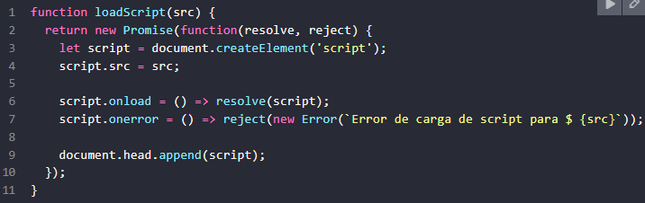

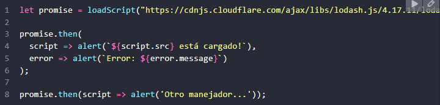

Podemos ver inmediatamente algunos beneficios sobre el patrón basado en callback: 

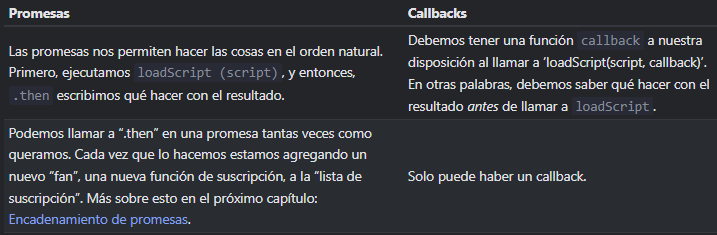

Encadenamiento de Promesa

encadenamiento de promesas\. Se ve así: 

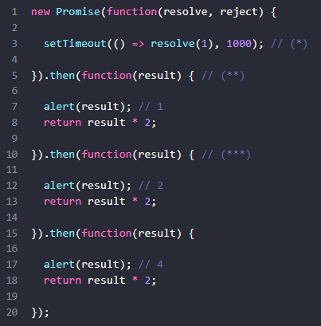

La idea es que el resultado pase a través de la cadena de manejadores “\.then”\.

Aquí el flujo es: 

La promesa inicial se resuelve en 1 segundo \(\*\)\, 

\(resuelta con el valor 2\)\. 

El siguiente \.then \(\*\*\*\) obtiene el resultado del anterior\, lo procesa \(duplica\) y lo pasa 

al siguiente manejador\. 

…y así sucesivamente\.

A medida que el resultado se pasa a lo largo de la cadena de controladores\, podemos ver una 

secuencia de llamadas de alerta: 1 → 2 → 4\.

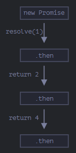

Todo funciona\, porque cada llamada a promise\.then devuelve una nueva promesa\, para que 

siguiente “\.then” 

convierte en el resultado de esa promesa\, por lo que se llama al siguiente “\.then”\.

Un error clásico de principiante: técnicamente también podemos agregar muchos ‘\.then’ a una 

sola promesa: eso no es encadenamiento\. Por ejemplo: 

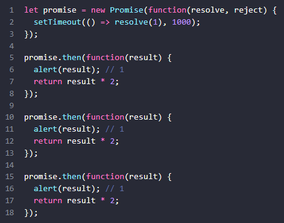

Lo que hicimos aquí fue añadir varios controladores a una sola promesa\. No se pasan el resultado 

el uno al otro; en su lugar\, lo procesan de forma independiente\. Aquí está la imagen \(compárala 

con el encadenamiento anterior\): 

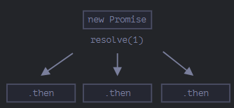

promesa\. Entonces\, en el código sobre todo alert muestra lo mismo: 1\. En la práctica\, rara vez 

necesitamos múltiples manejadores para una promesa\. El encadenamiento se usa mucho más a 

 _Devolviendo promesas _ 

Un controlador \(“handler”\)\, utilizado en “\.then\(handler\)”\, puede crear y devolver una promesa\. 

En ese caso\, otros manejadores esperan hasta que se estabilice \(resuelva o rechace\) y luego 

obtienen su resultado\. Por ejemplo: 

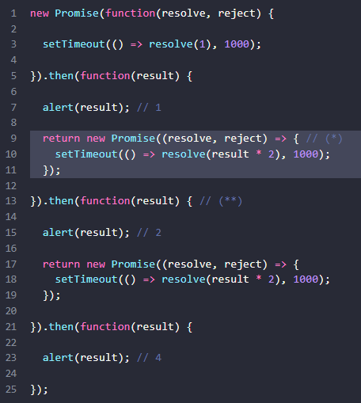

En este código e

l primer “\.then” muestra 1 y devuelve new Promise\(\.\.\.\) en la línea \(\*\)\. Después 

de un segundo\, se resuelve\, y el resultado \(el argumento de resolve\, aquí es result \* 2\) se pasa 

al controlador del segundo “\.then”\. Ese controlador está en la línea \(\*\*\)\, mues

tra 2 y hace lo 

Por lo tanto\, la salida es la misma que en el ejemplo anterior: 1 → 2 → 4\, pero ahora con 1 

segundo de retraso entre las llamadas de alerta\. Devolver las promesas nos permite construir 

cadenas de acciones asincrónicas\. 

 _El ejemplo: loadScript _ 

Usemos esta función con el loadScript promisificado\, definido en el capítulo anterior\, para cargar 

los scripts uno por uno\, en secuencia: 

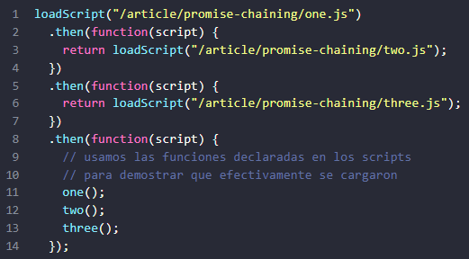

Este código se puede acortar un poco con las funciones de flecha: 

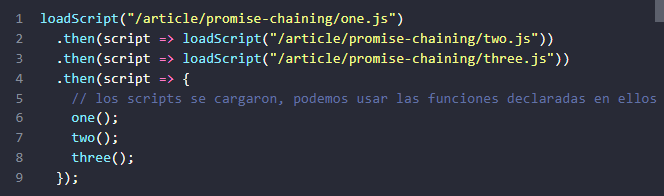

Aquí cada llamada a loadScript devuelve una promesa\, y el sig

uiente “\.then” se ejecuta cuando 

se resuelve\. Luego inicia la carga del siguiente script\. Entonces los scripts se cargan uno tras otro\. 

Podemos agregar más acciones asincrónicas a la cadena\. Tenga en cuenta que el código sigue 

siendo “plano”: crece hacia abajo\, no a la derecha\. No hay signos de la “pirámide del destino”\. 

Técnicamente\, podríamos agregar “\.then” directamente a cada loadScript\, así:

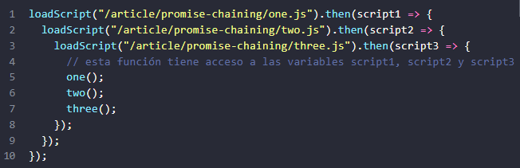

Este código hace lo mismo: carga 3 scripts en secuencia\. Pero “crece hacia la derecha”\. Entonces 

tenemos el mismo problema que con los callbacks\. Quienes comienzan a usar promesas pueden 

desconocer el encadenamiento\, y por ello escribirlo de esta manera\. En general\, se prefiere el 

encadenamiento\. 

A veces es aceptable escribir “\.then” directamente\, porque la funció

n anidada tiene acceso al 

variables script1\, script2\, script3\. Pero eso es una excepción más que una regla\. 

 _Ejemplo más grande: fetch _ 

En la programación “frontend”\, l

as promesas a menudo se usan para solicitudes de red\. Veamos 

un ejemplo extendido de esto\. 

remoto\. Tiene muchos parámetros opcionales cubiertos en capítulos separados\, pero la sintaxis 

básica es bastante simple: 

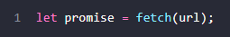

Esto hace una solicitud de red a la url y devuelve una promesa\. La promesa se resuelve con un 

objeto ‘response’ cuando el servidor remoto responde con encabezados\, pero antes de que se 

descargue la respuesta completa\.  

response\.text\(\): 

promesa que se resuelve cuando se descarga el texto completo del servidor remoto\, con ese 

texto como resultado\. El siguiente código hace una solicitud a user\.json y carga su texto desde 

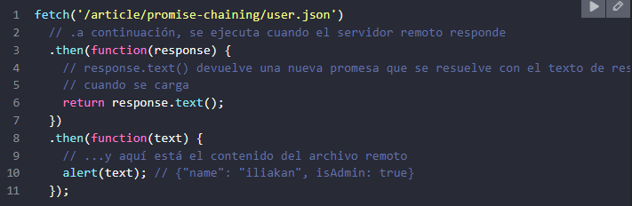

El objeto response devuelto por fetch también incluye el método response\.json\(\) que lee los 

datos remotos y los analiza como JSON\. En nuestro caso\, eso es aún más conveniente\, así que 

pasemos a ello\. También usaremos las funciones de flecha por brevedad: 

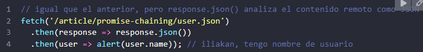

Ahora hagamos algo con el usuario cargado\. Por ejemplo\, podemos hacer una solicitud más a 

GitHub\, cargar el perfil de usuario y mostrar el avatar: 

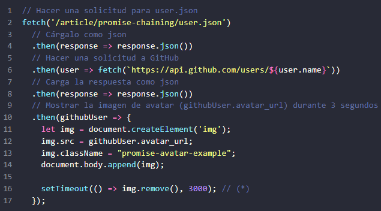

El código funciona; ver comentarios sobre los detalles\. Sin embargo\, hay un problema potencial\, 

un error típico para aquellos que comienzan a usar promesas\. 

mostrarse y se elimine? Por ejemplo\, nos gustaría mostrar un formulario para editar ese usuario 

u otra cosa\. A partir de ahora\, no hay manera\. 

Para que la cadena sea extensible\, debemos devolver una promesa que se resuelva cuando el 

avatar termine de mostrarse\. Como esto: 

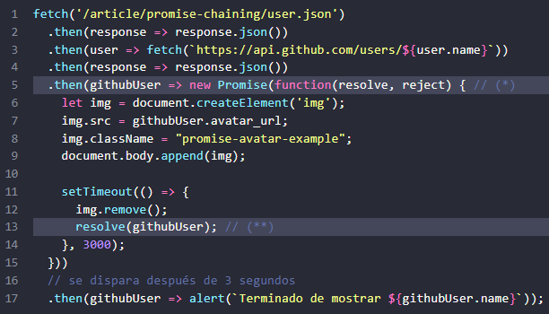

Es decir\, el controlador “\.then” en la línea \(\*\) ahor

a devuelve new Promise\, que se resuelve solo 

resolve\(githubUser\) 

cadena esperará eso\. 

Como buena práctica\, una acción asincrónica siempre debe devolver una promesa\. Eso hace 

posible planificar acciones posteriores; incluso si no planeamos extender la cadena ahora\, es 

posible que la necesitemos más adelante\. Finalmente\, podemos dividir el código en funciones 

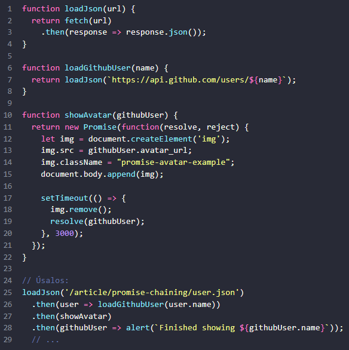

Si un controlador “\.

finally\, no importa\) devuelve una 

promesa\, el resto de la cadena espera hasta que ésta quede establecida 

\(sea resuelta o rechazada\)\. Cuando lo hace\, su resultado \(o error\) pasa 

más allá\. Aquí hay una imagen completa:

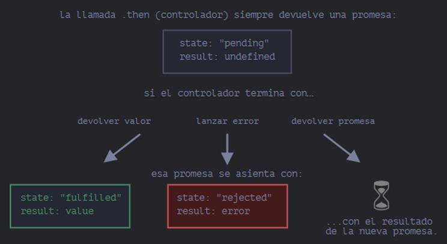

Manejo de errores con promesas

Las promesas encadenadas son excelentes manejando los errores\. Cuando una promesa es 

rechazada\, el control salta al manejador de rechazos más cercano\. Esto es muy conveniente en 

Por ejemplo\, en el código de abajo\, la URL a la cual se le hace fetch es incorrecta \(no existe el 

sitio\) y al ser rechazada “\.catch” maneja el error:

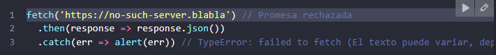

Como puedes ver\, el 

 no tiene que escribirse inmediatamente después de la promesa\. 

Este puede aparecer después de uno o quizás varios 

O\, puede ocurrir\, que todo en el sitio se encuentre bien\, pero la respuesta no es un JSON válido\. 

La forma más fácil de detectar todos los errores es agregando 

 al final de la cadena de 

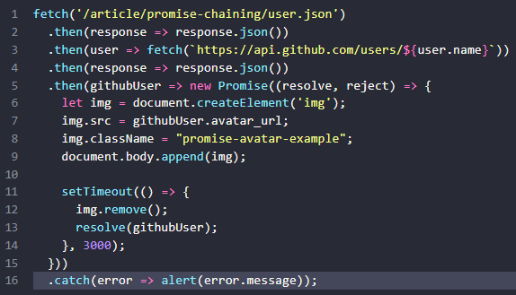

 _try…catch implícito_ 

"try\.\.catch invisible"\. Si ocurre una excepción\, esta es atrapada y es tratada como un rechazo\. 

Por ejemplo\, este código: 

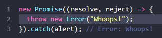

…Hace exactamente lo mismo que este:

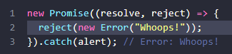

El "try\.\.catch invisible" embebido en el ejecutor detecta automáticamente el error y lo convierte 

en una promesa rechazada\. 

Esto sucede no solo en la función ejecutora\, sino también en sus manejadores\. Si hacemos throw 

dentro de una llamada a “\.then”\, esto devolverá una prom

esa rechazada\, por lo que el control 

salta al manejador de errores más cercano\. Por ejemplo: 

Esto sucede con todos los errores\, no solo los causados por la sentencia de excepción throw\. Por 

ejemplo\, un error de programación: 

 del final no solo detecta rechazos explícitos\, sino también los errores accidentales en 

los manejadores anteriores\. 

 _Rethrowing \(relanzamiento de errores\) _ 

Como ya vimos\, el “\.catch” del final es similar a “try\.\.catch”\. Podemos tener tantos manejadores 

“\.then” como queram

os\, y luego usar un solo \.catch al final para manejar los errores en todos 

ellos\. En un “try\.\.catch” normal\, podemos analizar el error y quizá volver a lanzarlo si no se puede 

manejar\. Lo mismo podemos hacer con las promesas\. 

Si hacemos throw dentro de “\.catch”\, el control pasa a otro manejador de errores más cercano\. 

Y\, si manejamos el error y terminamos de forma correcta\, entonces se continúa con el siguiente 

manejador “\.then” exitoso\. En el ejemplo de abajo\, el “\.catch” maneja el error de forma exitosa:

Aquí el “\.catch” termina de forma correcta\. Entonces se ejecuta el siguiente manejador exitoso 

En el siguiente ejemplo podemos ver otra situación con “\.catch”\. El manejador \(\*\) detecta el 

error y simplemente no puede manejarlo \(en el ejemplo solo sabe qué hacer con un URIError\)\, 

por lo que lo lanza nuevamente: 

La ejecución salta del primer 

 \(\*\) al siguiente \(\*\*\) en la cadena\. 

 _Rechazos no manejados _ 

¿Qué sucede cuanto un error no es manejado? Por ejemplo\, si olvidamos agregar 

final de una cadena de promesas\, como aquí: 

En caso de que se genere un error\, la promesa se rechaza y la ejecución salta al manejador de 

rechazos más cercano\. Pero aquí no hay ninguno\. Entonces el error se “atasca”\, ya que no hay 

código para manejarlo\. En la práctica\, al igual que con los errores comunes no manejados en el 

código\, esto significa que algo ha salido terriblemente mal\. 

¿Qué sucede cuando ocurre un error regular y no es detectado por try\.\.catch? El script muere 

con un mensaje en la consola\. Algo similar sucede con los rechazos de promesas no manejadas\. 

En este caso\, el motor de JavaScript rastrea el rechazo y lo envía al ámbito global\. Puedes ver en 

consola el error generado si ejecutas el ejemplo anterior\. En el navegador podemos detectar 

tales errores usando el evento unhandledrejection: 

Si se produce un error\, y no hay un “\.catch”\, se dispara unhandledrejection\, y se obtiene el 

objeto event el cual contiene información sobre el error\, por lo que podemos hacer algo con el 

error \(manejar el error\)\. 

Usualmente estos errores no son recuperables\, por lo que la mejor salida es informar al usuario 

sobre el problema y probablemente reportar el incidente al servidor\. En entornos fuera del 

navegador como Node\.js existen otras formas de rastrear errores no manejados\. 

unhandledrejection

Hay 6 métodos estáticos en la clase Promise\. Veremos sus casos de uso 

Digamos que queremos que muchas promesas se ejecuten en paralelo y esperar hasta que 

todas ellas estén listas\. 

Por ejemplo\, descargar varias URLs en paralelo y procesar su contenido en cuanto todas ellas 

finalicen\. Para ello es Promise\.all\. La sintaxis es: 

Promise\.all toma un iterable \(usualmente un array de promesas\) y devuelve una nueva 

Esta nueva promesa es resuelta en cuanto todas las promesas listadas se resuelven\, y el array 

de aquellos resultados se vuelve su resultado\. Por ejemplo\, el Promise\.all debajo se resuelve 

después de 3 segundos\, y su resultado es un array \[1\, 2\, 3\]: 

Ten en cuenta que el orden de los miembros del array es el mismo que el de las promesas que 

los originan\. Aunque la primera promesa es la que toma más tiempo en resolverse\, es aún la 

primera en el array de resultados\. 

podemos usar fetch en todos ellos así: 

Un mayor ejemplo con fetch: la búsqueda de información de usuario para un array de usuarios 

de GitHub por sus nombres \(o podríamos buscar un array de bienes por sus “id”\, la lógica es 

inmediatamente rechaza: “reject” con ese error\. Por ejemplo:

Aquí la segunda promesa se rechaza en dos segundos\. Esto lleva a un rechazo inmediato de 

Promise\.all\, entonces 

 se ejecuta: el error del rechazo se vuelve la salida del Promise\.all 

 _2\. Promise\.allSettled _ 

Promise\.all rechaza como un todo si cualquiera de sus promesas es rechazada\. Esto es bueno 

para los casos de “todo o nada”\, cuando necesitamos que todos los resultados sean 

Promise\.allSettled solo espera que todas las promesas se resuelvan sin importar sus resultados\. 

El array resultante tiene: 

\{status:"fulfilled"\, value:result\} para respuestas exitosas\, 

\{status:"rejected"\, reason:error\} para errores\. 

Por ejemplo\, quisiéramos hacer “fetch” de la información de múltiples usuarios\. Incluso si uno 

falla\, aún estaremos interesados en los otros\. Usemos Promise\.allSettled: 

El results de la línea \(\*\) de arriba será: 

Entonces para cada promesa obtendremos su estado y value/error\. 

Si el browser no soporta Promise\.allSettled\, es fácil implementarlo: 

if \(\!Promise\.allSettled\) \{ 

  const rejectHandler = reason => \(\{ status: 'rejected'\, reason \}\); 

  const resolveHandler = value => \(\{ status: 'fulfilled'\, value \}\); 

  Promise\.allSettled = function \(promises\) \{ 

convertedPromises 

Promise\.resolve\(p\)\.then\(resolveHandler\, 

rejectHandler\)\); 

    return Promise\.all\(convertedPromises\); 

En este código\, promises\.map toma los valores de entrada\, los transforma en promesas \(por si 

no lo eran\) con p => Promise\.resolve\(p\)\, entonces agrega un manejador “\.then” a cada una\.

Este manejador \(“handler”\) transforma un resultado exitoso value en \{status:'fulfilled'\, value\}\, y 

\{status:'rejected'\, 

Promise\.allSettled\. Ahora podemos usar Promise\.allSettled para obtener el resultado de todas 

las promesas dadas incluso si algunas son rechazadas\. 

 _4\. Promise\.race _ 

Similar a Promise\.all\, pero espera solamente por la primera respuesta y obtiene su resultado \(o 

error\)\. Su sintaxis es: 

Por ejemplo\, aquí el resultado será 1: 

La primera promesa fue la más rápida\, por lo que se vuelve resultado\. En cuanto una promesa 

responde\, “gana la carrera”

\, y todos los resultados o errores posteriores son ignorados\. 

Es similar a Promise\.race\, pero espera solamente por la primera promesa cumplida y obtiene su 

rechazada con AggregateError\, un error especial que almacena los errores de todas las promesas 

en su propiedad errors\. La sintaxis es: 

Por ejemplo\, aquí el resultado será 1: 

La primera promesa fue la más rápida\, pero fue rechazada entonces devuelve el resultado de la 

promesa cumplida “gana 

serán ignorados\. Aquí hay un ejemplo donde todas las promesas fallan: 

propiedad errors del objeto AggregateError\. 

 _6\. Promise\.resolve/reject _ 

Los métodos Promise\.resolve y Promise\.reject son raramente necesitados en código moderno 

porque la sintaxis async/await \(que veremos luego\) las hace algo obsoletas\. 

Las tratamos aquí para completar la cobertura y por aquellos casos que por algún motivo no 

puedan usar async/await\. 

 _Promise\.resolve _ 

Promise\.resolve\(value\) crea una promesa resuelta con el resultado value\. Tal como: 

compatibilidad\, 

Por ejemplo\, la función loadCached abajo busca una URL y recuerda \(en caché\) su contenido\. 

Futuros llamados con la misma URL devolverá el contenido de caché\, pero usa Promise\.resolve 

para hacer una promesa de él y así el valor devuelto es siempre una promesa: 

loadCached\(url\)\.then\(…\) 

Promise\.resolve en la línea \(\*\)\. 

Promise\.reject\(error\) crea una promesa rechazada con error\. Tal como: 

En la práctica este método casi nunca es usado\. 

Existen 6 métodos estáticos de la clase Promise:

Promise\.all\(promises\) 

espera que todas las promesas se resuelvan y devuelve un 

array de sus resultados\. Si cualquiera es rechazada se vuelve el error de Promise\.all

los demás resultados son ignorados\.

Promise\.allSettled\(promises\) \(método recientemente añadido\) 

espera que toda las 

promesas respondan y devuelve sus resultados como un array de objetos con:

status: "fulfilled" o "rejected"

fulfilled\) o reason \(si

Promise\.race\(promises\) 

espera a la primera promesa que responda y aquel 

resultado o error se vuelve su resultado o error\.

Promise\.any\(promises\) \(método recientemente añadido\) 

espera por la primera 

promesa que se cumpla y devuelve su resultado\. Si todas las promesas son 

rechazadas\, AggregateError

se vuelve el error de Promise\.any\.

Promise\.resolve\(value\) 

crea una promesa resuelta con el “

Promise\.reject\(error\) 

crea una promesa rechazada con el “error” dado

es probablemente el más común en la práctica\.

“Promisificación” es una simple transformación\. Es la conversión de una funci

ón que acepta un 

callback a una función que devuelve una promesa\. 

A menudo estas transformaciones son necesarias en la vida real ya que muchas funciones y 

librerías están basadas en callbacks\, pero las promesas son más convenientes así que tiene 

sentido promisificarlas\. Veamos un ejemplo\. Aquí tenemos loadScript\(src\, callback\) del artículo 

Introducción: callbacks\. 

La función carga un script con el src dado\, y llama a callback\(err\) en caso de error o callback\(null\, 

script\) en caso de carga exitosa\. Esto está ampliamente acordado en el uso de callbacks\, lo 

hemos visto antes\. Vamos a promisificarla\. 

Haremos una función nueva loadScriptPromise\(src\) que va a hacer lo mismo \(carga el script\)\, 

exitosa y rechaza con error en caso contrario\. Aquí está: 

Como podemos ver\, la nueva función es un “wrapper” \(una función contenedora\) que envuelv

la función loadScript original\. La llama proveyendo su propio callback y la traduce a una promesa 

resolve/reject\. 

Ahora loadScriptPromise se adapta bien a un código basado en promesas\. Si nos gustan más las 

promesas que los callbacks \(y pronto veremos más motivos para ello\)\, la usaremos en su lugar\. 

En la práctica podemos necesitar promisificar más de una función\, así que tiene sentido usar un 

función contenedora \(wrapper\)\. 

El código puede verse complicado\, pero es esencialmente lo mismo que escribimos arriba al 

promisificar la función loadScript\. 

contenedor devuelve una promesa y redirige el llamado a la f original\, siguiendo el resultado en 

el callback personalizado \(\*\*\)\. Aquí promisify asume que la función original espera un callback 

con dos argumentos \(err\, result\)\. Eso es lo que usualmente encontramos\. Entonces nuestro 

callback personalizado está exactamente en el formato correcto\, y promisify funciona muy bien 

¿Y si la f original espera un callback con más argumentos callback\(err\, res1\, res2\)? Podemos 

mejorar el ayudante\. Hagamos una versión de promisify más avanzada\. 

Cuando la llamamos como promisify\(f\)\, debe funcionar igual que en la versión previa\. 

Cuando la llamamos como promisify\(f\, true\)\, debe devolver una promesa que resuelve 

con el array de resultados del callback\. Esto es para callbacks con muchos argumentos\. 

Como puedes ver es esencialmente lo mismo de antes\, pero resolve es llamado con solo uno o 

con todos los argumentos dependiendo del valor de manyArgs\. Para formatos más exóticos de 

callback\(result\)\, 

promisificarlos 

manualmente sin usar el ayudante\. 

Existe una sintaxis especial para trabajar con promesas de una forma más confortable\, llamada 

“async/await”\. Es sorprendentemente fácil de entender y usar\.

 _Funciones async _ 

Comencemos con la palabra clave async\. Puede ser ubicada delante de una función como aquí: 

automáticamente\. Por ejemplo\, esta función devuelve una promesa resuelta con el resultado 

de 1; Probémosla: 

…Podríamos explícitamente devolver una promesa\, lo cual sería lo mismo:

Entonces\, async se asegura de que la función devuelva una promesa\, o envuelve las no promesas 

y las transforma en una\. Bastante simple\, ¿correcto? Pero no solo eso\. Hay otra palabra\, await\, 

que solo trabaja dentro de funciones async y es muy interesante\. 

await hace que JavaScript espere hasta que la promesa responda y devuelve su resultado\. Aquí 

hay un ejemplo con una promesa que resuelve en 1 segundo: 

La ejecución de la función es pausada en la línea \(\*\) y se reanuda cuando la promesa responde\, 

 literalmente suspende la ejecución de la función hasta que se establezca la 

promesa\, y luego la reanuda con el resultado de la promesa\. Eso no cuesta ningún recurso de 

CPU\, porque el motor de JavaScript puede hacer otros trabajos mientras tanto: ejecutar otros 

scripts\, manejar eventos\, etc\. Es simplemente una sintaxis más elegante para tener el resultado 

de una promesa que “promise\.then”\, es más fácil de leer y de escribir\.

 __Nota: “await” solo funciona den__ 

 __tro de una función async\. __ 

Tomemos el ejemplo showAvatar\(\) del capítulo Encadenamiento de promesas y rescribámoslo 

usando async/await: 

Necesitaremos reemplazar los llamados “\.then” con await\.

También debemos hacer que la función sea async para que aquellos funcionen\. 

Bien limpio y fácil de leer\, ¿no es cierto? Mucho mejor que antes\. 

Métodos de clase Async: Para declarar un método de clase async\, simplemente se le antepone 

 _Manejo de Error _ 

Si una promesa se resuelve normalmente\, entonces await promise devuelve el resultado\. Pero 

en caso de rechazo\, dispara un error\, tal como si hubiera una instrucción throw en aquella línea\. 

…es lo mismo que esto:

En situaciones reales\, la promesa tomará algún tiempo antes del rechazo\. En tal caso habrá un 

retardo antes de que await dispare un error\. Podemos atrapar tal error usando try\.\.catch\, de la 

misma manera que con un throw normal: 

En el caso de un error\, el control salta al bloque catch\. Podemos también envolver múltiples 

Si no tenemos try\.\.catch\, entonces la promesa generada por el llamado de la función async f\(\) 

se vuelve rechazada\. Podemos añadir 

 para manejarlo: 

Si olvidamos añadir 

 allí\, obtendremos un error de promesa no manejado \(visible en 

unhandledrejection\. 

El comando async

antes de una función tiene dos efectos:

Hace que siempre devuelva una promesa\.

Permite que sea usado await

El comando await

antes de una promesa hace que JavaScript espere hasta 

que la promesa responda\. Entonces:

Si es un error\, la excepción es generada 

lo mismo que si throw

error fuera llamado 

en ese mismo lugar\.

De otro modo\, devuelve el resultado\.

Juntos proveen un excelente marco para escribir código asincrónico que es 

fácil de leer y escribir\.

raramente necesitamos escribir promise\.then/catch\, pero 

aún no deberíamos olvidar que están basados en promesas porque a veces 

\(ej\. como en el nivel superior de código\) tenemos que usar esos métodos\. 

También Promise\.all

es adecuado cuando esperamos por varias tareas 

